# Stonecrab Architecture

**Status:** design document, derived from the [engineering specification](./SPEC.md) and
reconciled with the code at the alpha (slice S31) and with the single-crate build (slice S33, ADR-0018). The diagrams are the original targets.
Every section that has shipped carries a **Shipped at alpha** note that is authoritative
wherever it differs from the diagram above it, and anything a diagram shows that the alpha
does not ship is marked **deferred** with the slice or milestone that owns it (milestones
are those of SPEC.md 'Delivery milestones', slices those of
[`ALPHA_PLAN.md`](./ALPHA_PLAN.md)). The upstream baseline is pinned in
`upstream/manifest.toml`; M0 is not complete. Support levels per capability are in
[`COMPATIBILITY.md`](./COMPATIBILITY.md).

This document is the diagram set for the crate. It is organized from the outside in: module map first, then the public contract at the crate root (the core), then the layers beneath it, then the dynamic behavior (state machines and sequences) that the static diagrams cannot show.

Every diagram is Mermaid so it renders on GitHub and in `cargo doc` via `#![doc = include_str!(...)]` with `rustdoc`'s `--html-in-header` mermaid shim if we choose to embed it later.

## Notation

| Mark | Meaning |
| --- | --- |
| `<<trait>>` | Rust trait. Object-safe unless noted; the public driver boundary is always object-safe. |
| `<<enumeration>>` | Rust `enum`. All public enums are `#[non_exhaustive]`. |
| `<<newtype>>` | Single-field tuple struct used for type safety (`TagId`, `UnitId`). |
| `<<generated>>` | Produced by the MSpec → Rust generator; never hand-edited. |
| `OpFuture~T~` | `Pin<Box<dyn Future<Output = Result<T, PlcError>> + Send + '_>>` — the boxed future used at the object-safe boundary. |
| `Result~T~` | `Result<T, PlcError>` unless an error type is named. |
| `A --> B` | A holds or references B. |
| `A ..> B` | A uses B transiently (argument, return, or construction). |
| `A ..|> B` | A implements trait B. |
| `A *-- B` | A owns B (composition). |

Lifetimes, `Send + Sync` bounds, and `#[derive]` lists are omitted from the diagrams; the [coding standards](./CODING_STANDARDS.md) define the mandatory bounds and derives.

---

## 1. The crate and its modules

Stonecrab is one package, `stonecrab` 0.2.0 (ADR-0018). What the original design drew as
separate crates are modules of it; a module that carries a dependency sits behind a Cargo
feature (section 10). Dependencies point downward only: applications -> `stonecrab` ->
driver modules -> transport and codec -> the core at the crate root. Sensor metadata is kept
out of the wire-level modules. Tooling is never a dependency of the published package.

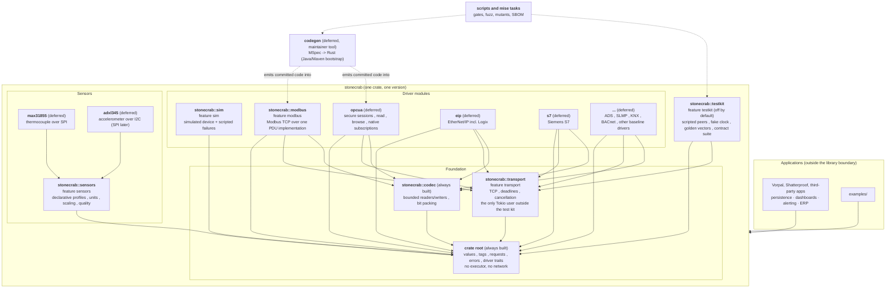

**Rules encoded in this graph**

- The crate root (the core) has no runtime dependency. Values, tags, requests, and errors must not change when a second async runtime is added later.
- `stonecrab::transport` is the only module that depends on Tokio apart from the test kit (`stonecrab::testkit`, which spawns scripted peers), and the `transport` feature is the only way Tokio enters the crate. Serial, SPI, and I2C access never runs on a runtime worker thread.
- Driver modules depend on `transport` and `codec`, never on each other. Shared Modbus PDU logic lives inside `stonecrab::modbus`, not in a cross-driver module.
- `stonecrab::sensors` depends only on the core; a profile is data about tags, not about wire bytes.
- Board adapters will depend on `sensors` so they share the measurement envelope and quality model, but they are not upstream-parity items.
- `cargo add stonecrab` enables the default features `sim`, `modbus` and `sensors`; `default-features = false` pulls in the core and the codec and nothing else, with no Tokio. A protocol outside the defaults is opt-in.
- The test kit is a module of this crate behind the `testkit` feature, not a separate crate, because a test crate that depends on `stonecrab` while `stonecrab` uses it in its tests is a dev-dependency cycle (ADR-0018).

**Shipped at alpha (D22, ADR-0018).** The alpha ships one crate. The graph above holds for
it, with the exceptions listed after the table.

| Module | Path | Feature | Normal dependencies | Notes |
| --- | --- | --- | --- | --- |
| core | crate root | none (always built) | `thiserror`, `bytes` | no executor, no network, no Tokio |
| `codec` | `stonecrab::codec` | none (always built) | the core | bounded readers and writers |
| `transport` | `stonecrab::transport` | `transport` | the core, `bytes`, `tokio` (`rt`, `net`, `time`, `sync`, `io-util`) | the only Tokio user outside the test kit; no spawned task |
| `sim` | `stonecrab::sim` | `sim` (default) | the core, `tracing` | Tokio-free; depends on neither transport nor codec (D9) |
| `modbus` | `stonecrab::modbus` | `modbus` (default) | the core, `codec`, `transport`, `tracing` | Modbus TCP reads only |
| `sensors` | `stonecrab::sensors` | `sensors` (default) | the core, `serde`, `toml` | depends on no driver |
| `testkit` | `stonecrab::testkit` | `testkit` (off) | the core, `transport`, `serde`, `serde_json`, `toml`, `tokio` (`macros`, task spawning for scripted peers) | test fixtures and the contract suite; not a runtime feature |

Where the alpha differs from the graph and the original brief:

- **Transport error type (D22).** `transport` does not depend on the codec. Its
  framing errors are the transport-local `FrameError` (`Truncated`, `Oversized`,
  `Malformed`) with `From<FrameError> for PlcError`, and `MbapFramer` in the Modbus module
  converts the codec's `ParseError` into it. The edges `TRANSPORT --> CORE` and
  `CODEC --> CORE` therefore stand, there is no `TRANSPORT --> CODEC` edge, and the
  `ParseError` that sections 4.1 and 4.2 show on `Framer` is `FrameError` as shipped.
  The two sections were inconsistent on this point; this is the recorded choice.
- **One crate, not many (S33, ADR-0018).** The graph was first built as seven crates; the
  maintainer decided on 2026-10-27 that Stonecrab ships as one crate that is simple to
  explain and to version. The module edges above are the former crate edges, and the
  lint promotions and coverage thresholds that were per crate are per module.
- **Deferred modules.** `opcua` (milestone M3), `eip` and `s7` (M4), the remaining
  baseline drivers (M5), both board adapters (M2S), the MSpec code generator (M5) and the
  differential runner (M5) do not exist. `xtask` does not exist either: its jobs are shell
  scripts under `scripts/` and mise tasks (ADR-0005). Serial and UDP transports and Modbus
  RTU are M2 and M3. Each arrives as a module behind its own feature; whether a large one
  is split into its own crate again is a decision for its ADR.
- **Drivers and shared modules.** The simulator depends on the core alone, so the rule that
  driver modules depend on transport and codec applies to `modbus` only.
- **Opt-in.** The defaults give the simulator, Modbus TCP and the sensor profiles; a build
  that wants less turns the defaults off and picks features (section 10).

---

## 2. Mapping from Apache PLC4X concepts

Behavioral compatibility, not structural translation. This table is the index into the parity records required by the spec.

| PLC4J concept | Stonecrab type | Notes |
| --- | --- | --- |
| `PlcDriverManager` | `DriverRegistry` | Explicit registration; no classpath scanning. Unsupported scheme is a typed error. |
| `PlcDriver` | `trait Driver` | Object-safe. `connect` returns an `OpFuture`. |
| `PlcConnection` | `trait Connection` | Explicit `close`; observable `ConnectionState`. |
| `PlcConnection.getMetadata()` | `Capabilities` | Reports native vs polling subscription honestly. |
| `PlcTag` / address string | `Tag` + `dyn ProtocolAddress` | Driver parses; caller-supplied `TagId` retained end-to-end. |
| `PlcValue` hierarchy | `enum PlcValue` | Exact integer widths preserved; no f64 funnel. |
| `PlcReadRequest` / `PlcReadResponse` | `ReadRequest` / `ReadResponse` | Per-item results correlated by `TagId`; partial failure preserved. |
| `PlcWriteRequest` / `PlcWriteResponse` | `WriteRequest` / `WriteResponse` | Adds `WriteOutcome::Unknown` for ambiguous timeouts. |
| `PlcResponseCode` | `ProtocolStatus` + `ItemError` | Original protocol status kept beside the normalized error. |
| `PlcSubscriptionRequest` | `SubscribeRequest` → `Subscription` | Bounded delivery; `QueuePolicy` and `LossCounters` are mandatory. |
| `PlcBrowseRequest` | `BrowseRequest` / `BrowseResponse` | Distinct from discovery; unsupported → `ErrorKind::Unsupported`. |
| `PlcDiscoveryRequest` | `DiscoverRequest` / `DiscoveredDevice` | Never enabled by merely importing a crate. |
| `PlcConnectionException` etc. | `PlcError { kind: ErrorKind, … }` | One error type; `ErrorKind` is the discriminator. |
| `CompletableFuture<T>` | `OpFuture<T>` | Cancellation semantics documented per operation. |
| MSpec protocol definitions | `codegen` output in each driver module | Source revision, generator version, and options recorded with output. |

---

## 3. The core: public contract at the crate root

The whole public API surface that applications and drivers agree on. Nothing here knows about any protocol, transport, or runtime.

### 3.1 Driver and connection boundary

```mermaid
classDiagram
    direction TB

    class DriverRegistry {
        -drivers: BTreeMap~str, Arc~dyn Driver~~
        +new() DriverRegistry
        +register(driver: Arc~dyn Driver~) Result~()~
        +driver(scheme: str) Option~Arc~dyn Driver~~
        +schemes() Vec~str~
        +parse(uri: str) Result~ConnectionConfig~
        +connect(uri: str) OpFuture~Box~dyn Connection~~
    }

    class Driver {
        <<trait>>
        +scheme() str
        +capabilities() Capabilities
        +parse_config(uri: str) Result~ConnectionConfig~
        +parse_address(text: str, options: AddressOptions) Result~Arc~dyn ProtocolAddress~~
        +connect(cfg: ConnectionConfig) OpFuture~Box~dyn Connection~~
    }

    class Connection {
        <<trait>>
        +state() ConnectionState
        +watch_state() StateWatch
        +capabilities() Capabilities
        +limits() ResourceLimits
        +read(req: ReadRequest) OpFuture~ReadResponse~
        +write(req: WriteRequest) OpFuture~WriteResponse~
        +subscribe(req: SubscribeRequest) OpFuture~Subscription~
        +browse(req: BrowseRequest) OpFuture~BrowseResponse~
        +discover(req: DiscoverRequest) OpFuture~Vec~DiscoveredDevice~~
        +close() OpFuture~()~
    }

    class ConnectionConfig {
        +scheme: String
        +endpoint: Endpoint
        +options: BTreeMap~String, String~
        +timeouts: Timeouts
        +reconnect: ReconnectPolicy
        +read_retry: RetryPolicy
        +policy: AccessPolicy
        +limits: ResourceLimits
        +credentials: Option~Secret~Credentials~~
        +builder() ConnectionConfigBuilder
    }

    class Endpoint {
        <<enumeration>>
        Tcp(host, port)
        Udp(host, port)
        Serial(SerialSettings)
        Custom(String)
    }

    class Timeouts {
        +connect: Duration
        +request: Duration
        +idle: Option~Duration~
    }

    class ReconnectPolicy {
        +initial: Duration
        +max: Duration
        +multiplier: f64
        +jitter: Jitter
        +max_attempts: Option~u32~
        +next_delay(attempt: u32, rng) Duration
    }

    class RetryPolicy {
        +max_attempts: u32
        +retry_on: ErrorKindSet
        +note: "reads only — writes are never auto-retried"
    }

    class AccessPolicy {
        <<enumeration>>
        ReadOnly
        ReadWrite
    }

    class ResourceLimits {
        +max_frame_bytes: NonZeroUsize
        +max_buffered_bytes: NonZeroUsize
        +max_pending_requests: NonZeroUsize
        +max_queued_events: NonZeroUsize
        +max_items_per_request: Option~NonZeroUsize~
    }

    class Capabilities {
        +read: bool
        +write: bool
        +subscribe: SubscriptionMode
        +browse: bool
        +discover: bool
        +max_items_per_request: Option~NonZeroUsize~
        +max_pdu_bytes: Option~NonZeroUsize~
        +concurrency: NonZeroUsize
        +supports(op: Operation) bool
    }

    class SubscriptionMode {
        <<enumeration>>
        Unsupported
        Native
        Polling
    }

    class ConnectionState {
        <<enumeration>>
        Disconnected
        Connecting
        Connected
        Reconnecting(attempt: u32, next_at: Instant)
        Closing
        Closed
        Failed(ErrorKind)
    }

    class StateWatch {
        +current() ConnectionState
        +changed() OpFuture~ConnectionState~
    }

    class Secret~T~ {
        <<newtype>>
        -inner: T
        +expose() T
        +Debug prints REDACTED
    }

    DriverRegistry "1" o-- "*" Driver : registers
    DriverRegistry ..> ConnectionConfig : parses
    Driver ..> ConnectionConfig : accepts
    Driver ..> Connection : creates
    Driver ..> Capabilities : reports
    ConnectionConfig *-- Endpoint
    ConnectionConfig *-- Timeouts
    ConnectionConfig *-- ReconnectPolicy
    ConnectionConfig *-- RetryPolicy
    ConnectionConfig *-- AccessPolicy
    ConnectionConfig *-- ResourceLimits
    ConnectionConfig --> Secret~T~ : credentials
    Connection --> Capabilities
    Connection --> ConnectionState
    Connection --> StateWatch
    Capabilities --> SubscriptionMode
    ConnectionState ..> ErrorKind : Failed carries

    note for Driver "Object-safe. Drivers are stateless factories;\nall per-connection state lives behind Connection."
    note for Connection "Every method has documented cancel-safety.\nRequests rejected during local validation perform no I/O."
    note for RetryPolicy "Applies to reads only. Some registers have read\nside effects, so the budget is per-connection configurable."
```

**Shipped at alpha (ADR-0011, ADR-0008).** This note is authoritative where it differs
from the diagram, which is the original target and is not redrawn.

`Driver` is object safe and `Send + Sync`, a stateless factory:

| Method | Shipped signature |
| --- | --- |
| `scheme` | `fn scheme(&self) -> &'static str` |
| `capabilities` | `fn capabilities(&self) -> Capabilities` (by value; `Capabilities` is `Copy`) |
| `parse_config` | `fn parse_config(&self, uri: &str) -> Result<ConnectionConfig>` |
| `parse_address` | `fn parse_address(&self, text: &str, options: &AddressOptions) -> Result<Arc<dyn ProtocolAddress>>` |
| `connect` | `fn connect(&self, config: ConnectionConfig) -> OpFuture<'_, Box<dyn Connection>>` |

`parse_address` takes the caller's `AddressOptions` (D16): a `Clone`, `#[non_exhaustive]`
carrier of the optional `address-convention` name, so the convention is chosen explicitly
and never held as driver state. `ConnectionConfig::address_options()` returns it, and a
caller takes it before `connect` consumes the configuration (the configuration holds
credentials in a `Secret`, which is not `Clone`, so it is passed by value and is itself not
`Clone`). `connect` is bounded by `Timeouts.connect`; there is no connect without a
deadline.

`Connection` is the narrow set of D2, object safe and `Send + Sync`:

| Method | Shipped signature |
| --- | --- |
| `state` | `fn state(&self) -> ConnectionState` |
| `watch_state` | `fn watch_state(&self) -> StateWatch` |
| `capabilities` | `fn capabilities(&self) -> Capabilities` |
| `limits` | `fn limits(&self) -> ResourceLimits` (the request builders need the item budget) |
| `read` | `fn read(&self, request: ReadRequest) -> OpFuture<'_, ReadResponse>` |
| `write` | `fn write(&self, request: WriteRequest) -> OpFuture<'_, WriteResponse>` |
| `close` | `fn close(&self) -> OpFuture<'_, ()>` (bounded by `Timeouts.request`) |

**Deferred:** `subscribe` (M2, D4), `browse` and `discover` (M3), drawn in the diagram
above but not shipped. They will be added as
provided methods returning `Unsupported`, which is additive for implementors; their
request, response and event types (`SubscribeRequest`, `Subscription`, `QueuePolicy`,
`LossCounters`, `BrowseRequest`, `DiscoverRequest` and the rest) do not exist at alpha
(ADR-0001: no empty scaffolds).

`DriverRegistry` is populated at setup time: `register(&mut self, Arc<dyn Driver>)
-> Result<()>` (a duplicate scheme is `InvalidConfig`), `driver(&str)`, `schemes()` (sorted),
`parse(&str) -> Result<(Arc<dyn Driver>, ConnectionConfig)>` and `connect(&str)`. It takes
the scheme from `ConnectionUri::parse` and hands the original text to
`Driver::parse_config`; an unknown scheme is `Unsupported(Operation::Connect)`. There is no
lock and no global registry.

`ConnectionConfig` has private fields with accessors, is built by
`ConnectionConfig::builder(scheme, endpoint)` and validated at `build`. It differs from the
diagram in three ways:

- `Endpoint` has `Tcp { host, port }` and `Custom(String)`; `Udp` and `Serial` arrive with
  their transports (M3 and M2).
- The `options: BTreeMap` is gone. The shared `address-convention` key is carried as
  `AddressOptions`, and options only one driver understands travel in the **`DriverOptions`
  slot**: `DriverOptions` is a method-free `Any + Debug + Send + Sync` trait, stored as
  `Arc<dyn DriverOptions>` by `ConnectionConfigBuilder::driver_options` and read back by
  `ConnectionConfig::driver_options_as::<T>()`. A TCP endpoint cannot carry query text, so
  `ModbusTcpDriver::parse_config` puts its parsed `ModbusOptions` there and `connect`
  reads them; a configuration built by hand carries none and the driver falls back to its
  defaults. The simulator keeps its options in the text of `Endpoint::Custom`.
- `ReconnectPolicy::next_delay(attempt, sample: f64)` is pure (no random source in core),
  `RetryPolicy.retry_on` is a `BTreeSet<ErrorKind>` (default `{Timeout, Disconnected,
  Backpressure}`, equal to `PlcError::is_retryable`), `AccessPolicy` defaults to
  `ReadOnly`, and `Timeouts.idle` is recorded and **not enforced** at alpha because no
  background task exists (M2).

`ResourceLimits.max_items_per_request` is a mandatory `NonZeroUsize`, not an `Option`;
`Capabilities` and `ResourceLimits` are `Copy` and returned by value. `Capabilities` is
`#[non_exhaustive]` with public fields and `supports(Operation)`. `ConnectionState`,
`StateWatch` and `StateCell` are as in the diagram (`StateCell` is the writer side; section
3.4). Every `OpFuture` method states its deadline source and documents `# Cancel safety`
and `# Wire effects`.

### 3.2 Tags, addresses, and values

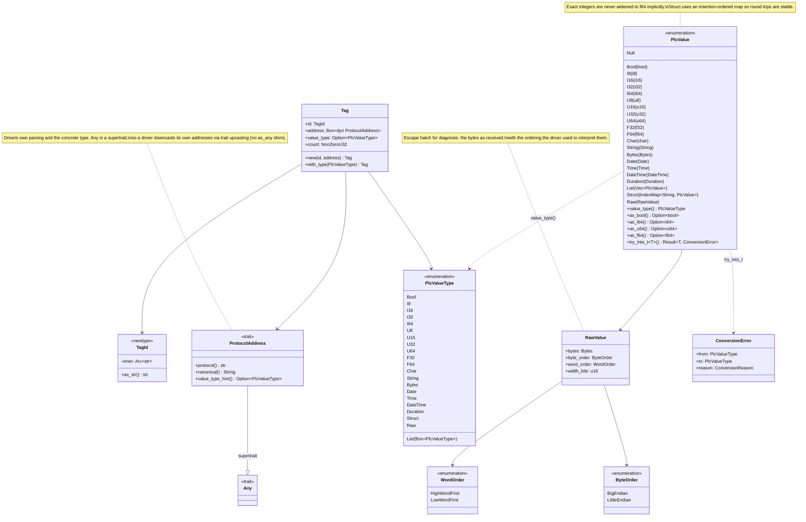

**Shipped at alpha (ADR-0006, ADR-0011).** `Tag` holds `Arc<dyn ProtocolAddress>`, not a
`Box`, because `Tag::new(id, address)` shares the address that `Driver::parse_address`
returned and a profile reuses one address for several tags. Its fields are private with
accessors (`id`, `address`, `value_type`, `count`, `byte_order`, `word_order`) and
builders `with_type` (checked against the address's hint), `with_count`, `with_byte_order`
and `with_word_order`; the last two are optional and never inferred. `count` is set after
parsing, invisible to `parse_address`, and the Modbus connection rejects a count other
than 1 before any I/O (array selections are M2).

`ProtocolAddress` is `Any + Debug + Send + Sync` with `protocol()`, `canonical()` and
`value_type_hint()`; a driver downcasts its own addresses through trait upcasting.

`PlcValue` ships `Null`, `Bool`, `I8` to `I64`, `U8` to `U64`, `F32`, `F64`, `Char`,
`String` and `Duration`, with `value_type()`, `as_bool`, `as_i64`, `as_u64` and `as_f64`
(integer access never silently widens a counter to floating point). **Deferred:**
`Bytes`, `Date`, `Time`, `DateTime`, `List`, `Struct` and `Raw` (and `RawValue` with them):
ADR-0006 keeps the unscaled typed value in `Measurement.raw` and the received register
bytes on a decode failure's `ProtocolStatus` instead, and the calendar and structured
values wait for an ADR before their first consumer (section 11). `ByteOrder` and
`WordOrder` are exhaustive two-variant enums. The diagram is not redrawn.

### 3.3 Requests, responses, and errors

```mermaid
classDiagram
    direction TB

    class ReadRequest {
        +items: Vec~Tag~
        +deadline: Option~Deadline~
        +cancel: Option~CancellationToken~
        +builder() ReadRequestBuilder
    }

    class ReadResponse {
        +items: Vec~ReadItem~
        +started_at: Instant
        +finished_at: Instant
        +split_into: NonZeroU32
        +get(id: TagId) Option~ReadItem~
        +iter_ok() Iterator
        +iter_failed() Iterator
    }

    class ReadItem {
        +tag: TagId
        +outcome: Result~PlcValue, ItemError~
        +status: Option~ProtocolStatus~
        +sampled_at: Instant
        +source_time: Option~SystemTime~
    }

    class WriteRequest {
        +items: Vec~WriteItem~
        +deadline: Option~Deadline~
        +cancel: Option~CancellationToken~
    }

    class WriteItem {
        +tag: Tag
        +value: PlcValue
    }

    class WriteResponse {
        +items: Vec~WriteResult~
        +started_at: Instant
        +finished_at: Instant
    }

    class WriteResult {
        +tag: TagId
        +outcome: WriteOutcome
        +status: Option~ProtocolStatus~
    }

    class WriteOutcome {
        <<enumeration>>
        Confirmed
        Rejected(ItemError)
        Unknown(UnknownReason)
    }

    class UnknownReason {
        <<enumeration>>
        TimeoutAfterTransmit
        DisconnectedAfterTransmit
        CancelledAfterTransmit
    }

    class SubscribeRequest {
        +items: Vec~Tag~
        +mode: SubscriptionMode
        +interval: Option~Duration~
        +queue: QueuePolicy
        +stale_after: Option~Duration~
    }

    class Subscription {
        +id: SubscriptionId
        +mode: SubscriptionMode
        +effective_interval: Option~Duration~
        +events: BoundedReceiver~SubscriptionEvent~
        +loss: LossCounters
        +unsubscribe() OpFuture~()~
    }

    class SubscriptionEvent {
        <<enumeration>>
        Value(ReadItem)
        Stale(TagId, age: Duration)
        Loss(LossSnapshot)
        StateChanged(ConnectionState)
        Ended(ErrorKind)
    }

    class QueuePolicy {
        <<enumeration>>
        Backpressure(capacity: NonZeroUsize)
        CoalesceLatest
        DropOldest(capacity: NonZeroUsize)
    }

    class LossCounters {
        +dropped: AtomicU64
        +coalesced: AtomicU64
        +missed_ticks: AtomicU64
        +snapshot() LossSnapshot
    }

    class BrowseRequest {
        +root: Option~Box~dyn ProtocolAddress~~
        +depth: Option~NonZeroU32~
        +filter: Option~BrowseFilter~
    }

    class BrowseResponse {
        +nodes: Vec~BrowseNode~
        +truncated: bool
    }

    class BrowseNode {
        +address: Box~dyn ProtocolAddress~
        +name: String
        +value_type: Option~PlcValueType~
        +readable: bool
        +writable: bool
        +subscribable: bool
        +children: Option~NonZeroU32~
    }

    class PlcError {
        +kind: ErrorKind
        +message: String
        +source: Option~Box~dyn Error~~
        +diagnostics: Diagnostics
        +new(kind, message) PlcError
        +with_source(err) PlcError
        +is_retryable() bool
    }

    class ErrorKind {
        <<enumeration>>
        InvalidConfig
        InvalidAddress
        Unsupported(Operation)
        Timeout
        Cancelled
        Disconnected
        Authentication
        Trust
        MalformedData
        DeviceException
        ResourceLimit
        Backpressure
        Internal
    }

    class ItemError {
        +kind: ErrorKind
        +status: Option~ProtocolStatus~
        +message: String
    }

    class ProtocolStatus {
        +protocol: str
        +code: u32
        +name: Option~str~
        +raw: Option~Bytes~
    }

    class Diagnostics {
        +operation: Operation
        +connection_state: ConnectionState
        +latency: Option~Duration~
        +retries: u32
        +category: FailureCategory
        +redacted: bool
    }

    class Operation {
        <<enumeration>>
        Connect
        Read
        Write
        Subscribe
        Browse
        Discover
        Close
    }

    ReadRequest "1" *-- "1..*" Tag
    ReadResponse "1" *-- "1..*" ReadItem
    ReadItem --> PlcValue
    ReadItem --> ItemError
    ReadItem --> ProtocolStatus
    WriteRequest "1" *-- "1..*" WriteItem
    WriteItem --> Tag
    WriteItem --> PlcValue
    WriteResponse "1" *-- "1..*" WriteResult
    WriteResult --> WriteOutcome
    WriteOutcome --> ItemError
    WriteOutcome --> UnknownReason
    SubscribeRequest *-- QueuePolicy
    SubscribeRequest "1" *-- "1..*" Tag
    Subscription --> SubscriptionEvent
    Subscription *-- LossCounters
    SubscriptionEvent --> ReadItem
    BrowseResponse "1" *-- "*" BrowseNode
    PlcError --> ErrorKind
    PlcError *-- Diagnostics
    ItemError --> ErrorKind
    ItemError --> ProtocolStatus
    Diagnostics --> Operation
    Diagnostics --> ConnectionState
    ErrorKind --> Operation : Unsupported carries

    note for ReadResponse "split_into > 1 means the driver split the batch to meet\ndevice limits; sampled_at differs per item and is disclosed."
    note for WriteOutcome "Unknown is a first-class result. The library never\nreplays a write to resolve it."
    note for QueuePolicy "Silent loss is prohibited. Every policy feeds LossCounters;\nBackpressure blocks the producer instead of dropping."
    note for PlcError "One error type crate-wide. Connection-level failures and\nper-tag device exceptions are never conflated."
```

**Shipped at alpha (ADR-0003, ADR-0010, ADR-0011).**

- Request builders are limits-bound: `ReadRequest::builder(limits)` and
  `WriteRequest::builder(limits)` take the connection's `ResourceLimits`, accept
  `tag`/`item`, an absolute `deadline(Deadline)` and `cancel(CancellationToken)`, and
  `build()` fails (sticky errors, before any collection grows) on an empty batch, a
  duplicate `TagId` or an item over the budget.
- `ReadResponse::builder(&request, started, finished)` restores request order and
  rejects missing, duplicate and unexpected identities and a reversed interval.
  `split_into()` is a `NonZeroU32` that discloses how many wire requests served the batch;
  `sampled_at` is per item. `ReadItem` carries `outcome()`, an optional `ProtocolStatus`,
  `sampled_at` and `source_time()`, which is `None` unless the device supplied one and is
  never filled from another clock.
- `ItemError` wraps a `PlcError` and an optional `ProtocolStatus`. `ProtocolStatus` holds
  the protocol name, the original code and name, and bounded raw bytes
  (`with_raw(bytes, max)`, never printed by `Debug`).
- `PlcError` has private fields and accessors (`kind`, `diagnostics`, `is_retryable`; the
  message is its `Display`) with `with_source` and `with_diagnostics`; `Diagnostics` fields are
  optional (`operation`, `connection_state`, `latency`, `category`) plus a `retries`
  count, and a core validation error does not invent them. `ErrorKind` is as drawn and is
  totally ordered (additive `Ord`).
- Write batches (`WriteItem`, `WriteRequest`, `WriteResult`, `WriteResponse`) and
  `WriteOutcome::{Confirmed, Rejected, Unknown(UnknownReason)}` exist as correlated data
  and the simulator implements `write` (including `Unknown` after transmit). The Modbus
  driver reports `write: false` and rejects writes before any I/O; Modbus write PDUs and
  `WriteOutcome::Unknown` on the wire are deferred (first post-alpha slices, D3).
- **Deferred:** `SubscribeRequest`, `Subscription`, `SubscriptionEvent`, `QueuePolicy`,
  `LossCounters` (M2, D4) and `BrowseRequest`, `BrowseResponse`, `BrowseNode` (M3).

The diagram is not redrawn.

### 3.4 Time and cancellation primitives


**Shipped at alpha (ADR-0007, ADR-0011).**

- `Clock` is `Send + Sync` with `now()`, `wall_now()` and `sleep_until(Instant) ->
  OpFuture<'_, ()>`. Core ships no implementation (it has no timer). `SystemClock` lives
  in `stonecrab::transport`, not in core: a unit struct whose `now()` is Tokio's instant,
  so paused-time tests agree with `Deadline`. The Tokio-free implementations are
  `FakeClock` in `stonecrab::testkit` (advanced by hand) and `RealtimeClock` in the simulator
  (`std` only, `sleep_until` resolves at once).
- `Deadline::after(now, duration) -> Result<Deadline>` takes the clock reading
  explicitly, with no hidden clock; `remaining(now)` and `is_elapsed(now)` are as drawn.
  A connection derives its default deadline from its own clock,
  `Deadline::after(clock.now(), timeouts.request)`, so a caller who injects a clock
  derives deadlines from the same one.
- `OpFuture<'a, T>` is `Pin<Box<dyn Future<Output = Result<T>> + Send + 'a>>`; there is
  no `async-trait`.
- `CancellationToken` is cloneable with `new`, `child`, `cancel`, `is_cancelled` and
  `cancelled() -> OpFuture<'_, ()>`: `cancel` is idempotent, wakes each waiter once and
  reaches children (held weakly) but never the parent. A request carries an optional token
  in its cancel slot and the connection enforces it.
- `StateCell::new(initial) -> (StateCell, StateWatch)`, `set`, `current`, `watch`; a
  `StateWatch` has `current()` and `changed() -> OpFuture<'_, ConnectionState>` with
  latest-value semantics (intermediate states coalesce; the machine records every
  transition in tracing events).
- **Deferred:** `StaleTracker` and the `Quality::Stale` it would produce (M2, with the
  polling loop). The diagram's `SystemClock ..|> Clock` edge holds, in the transport module.

The diagram is not redrawn.

---

## 4. `stonecrab::transport` and `stonecrab::codec`

### 4.1 Transport

```mermaid
classDiagram
    direction TB

    class Transport {
        <<trait>>
        +send(frame: Bytes, deadline: Deadline) OpFuture~()~
        +recv(buf: BytesMut, deadline: Deadline) OpFuture~usize~
        +shutdown() OpFuture~()~
        +peer() String
        +limits() ResourceLimits
    }

    class TransportFactory {
        <<trait>>
        +open(endpoint: Endpoint, limits: ResourceLimits, deadline: Deadline) OpFuture~Box~dyn Transport~~
    }

    class TcpTransport {
        -stream: TcpStream
        -limits: ResourceLimits
        +nodelay: bool
        +keepalive: Option~Duration~
    }

    class UdpTransport {
        -socket: UdpSocket
        -peer: SocketAddr
        -limits: ResourceLimits
    }

    class SerialTransport {
        -port: SerialPort
        -worker: BlockingWorker
        -settings: SerialSettings
        +inter_frame_silence() Duration
        +drain(deadline: Deadline) OpFuture~()~
    }

    class SerialSettings {
        +path: PathBuf
        +baud: u32
        +data_bits: DataBits
        +parity: Parity
        +stop_bits: StopBits
        +flow_control: FlowControl
    }

    class BlockingWorker {
        -thread: JoinHandle
        -tx: BoundedSender~SerialCommand~
        +note: "dedicated OS thread; never blocks a runtime worker"
    }

    class Framer~F~ {
        <<trait>>
        +decode(buf: BytesMut) Result~Option~F~, ParseError~
        +encode(frame: F, out: BytesMut) Result~(), ParseError~
        +max_frame_bytes() NonZeroUsize
    }

    class FramedTransport~F~ {
        -inner: Box~dyn Transport~
        -framer: Box~dyn Framer~F~~
        -rx_buf: BytesMut
        +next_frame(deadline: Deadline) OpFuture~F~
        +send_frame(frame: F, deadline: Deadline) OpFuture~()~
        +resync() OpFuture~()~
    }

    class ConnectionGuard {
        -state: ConnectionState
        -pending: Option~PendingRequest~
        -reconnect: ReconnectPolicy
        -cancel: CancellationToken
        +note: "one owner per connection; drivers wrap this"
    }

    TcpTransport ..|> Transport
    UdpTransport ..|> Transport
    SerialTransport ..|> Transport
    SerialTransport *-- SerialSettings
    SerialTransport *-- BlockingWorker
    TransportFactory ..> Transport : opens
    FramedTransport~F~ --> Transport
    FramedTransport~F~ --> Framer~F~
    ConnectionGuard --> FramedTransport~F~
    ConnectionGuard --> ReconnectPolicy
    ConnectionGuard --> CancellationToken

    note for Transport "Every call takes a Deadline. There is no unbounded I/O\nanywhere in the crate."
    note for FramedTransport~F~ "Owns the receive buffer so TCP fragmentation and\ncoalescing are invisible to the driver."
```

**Shipped at alpha (ADR-0014).** The diagram is the original target; this note is
authoritative where they differ.

| Item | Shipped shape |
| --- | --- |
| `Transport` (`Send`, object safe) | `send(&mut self, Bytes, Deadline) -> OpFuture<'_, ()>`; `recv(&mut self, &mut BytesMut, Deadline) -> OpFuture<'_, usize>` (`0` means the peer closed); **`shutdown(&mut self, Deadline) -> OpFuture<'_, ()>`**; `peer() -> &Endpoint`; `limits() -> &ResourceLimits` |
| `TransportFactory` (`Send + Sync`) | `open(&self, &Endpoint, ResourceLimits, Deadline) -> OpFuture<'_, Box<dyn Transport>>` |
| `TcpTransport`, `TcpFactory { nodelay }` | feature `transport` (off by default, on through `modbus` and `testkit`): name resolution and connect inside one connect deadline; refused or reset peers are `Disconnected`; `recv` bounded by `max_buffered_bytes`, `send` by `max_frame_bytes`; a `send` cut short poisons the transport. No keepalive field. |
| `Framer<F>` (`Send`) | `decode(&mut self, &mut BytesMut) -> Result<Option<F>, FrameError>`; `encode(&mut self, &F, &mut BytesMut) -> Result<(), FrameError>`; `max_frame_bytes() -> usize` |
| `FramedTransport<F, R>` | `new(Box<dyn Transport>, R)`; `next_frame(Deadline)`; `send_frame(&F, Deadline)`; **`resync(Deadline)`**; owns the receive buffer, bounded by `max_buffered_bytes` |
| `ConnectionGuard<F, R>` | `connect`, `request(frame, deadline, token)`, `request_with_default_deadline`, `next_reply(deadline, token)`, `close`, `state`, `watch_state`, `stats`; `GuardConfig`, `GuardStats` |
| `FrameError` | `Truncated`, `Oversized(usize)`, `Malformed`, with `From<FrameError> for PlcError` (D22) |
| `SystemClock`, `Jitter` | the Tokio-backed `Clock` and the xorshift64* sample source for `ReconnectPolicy::next_delay` |

Every call that waits takes the `Deadline` it must finish by, and that argument is the
only deadline source. `shutdown(Deadline)` is idempotent and closes from its first poll.
`resync(Deadline)` realigns the receive stream after a framing error or an abandoned
request: it asks the framer to decode the front of the buffer, keeps receiving while the
front is a plausible header, and discards one byte at a time while the framer rejects it;
without a frame boundary before the deadline the result is `Disconnected` and the owner
reopens the connection. Its deadline is the remaining deadline of the request whose
timeout triggered it, or `Deadline::after(clock.now(), timeouts.request)` from close or
recovery. `FramedTransport::next_frame` handles fragmentation and coalescing, so the
driver never sees them.

`ConnectionGuard` owns one connection and is the state machine of section 8. It is not a
struct of public fields as drawn: the pending slot, reconnect policy and token are
private. It offers one in-flight request on a single slot with an admission queue bounded
by `ResourceLimits.max_pending_requests` (`Backpressure` beyond it), request-driven
reconnect, a resync before the next send after a timeout, and a `close` bounded by
`Timeouts.request`. Nothing is spawned and nothing runs between calls (D15).

**Deferred:** `UdpTransport` (M3), `SerialTransport`, `SerialSettings` and
`BlockingWorker` (M2, with Modbus RTU), TLS transports (M3), and the TCP `keepalive`
option.

### 4.2 Codec primitives and generated-message support


**Shipped at alpha (ADR-0013).** `BoundedReader` and `BoundedWriter` ship with explicit
`ByteOrder` readers and writers for 8-, 16-, 32- and 64-bit integers and floats, bounded
byte runs, least-significant-bit-first coil bits (`read_bits_lsb_first`,
`write_bits_lsb_first`, `coil_byte_count`, `pack_bits_lsb_first`, `unpack_bits_lsb_first`),
`expect_eof` and `as_slice`/`into_bytes`; the writer is capacity-bounded rather than
limit-and-`finish`. `ParseError` has `Truncated`, `OversizedLength`, `InvalidDiscriminator`,
`TrailingBytes` and `Overflow`, with `From<ParseError> for PlcError`. Every length is
checked against the caller's maximum and the bytes present before allocation, and no
function panics on any input.

**Deferred:** `InvalidChecksum` and `RecursionLimit`, the `Checksum` trait and `Crc16Modbus`
(M2, with Modbus RTU); `MessageCodec`, `GenerationManifest` and `MspecFeatureMatrix`
(M5: nothing is generated, the Modbus PDUs are hand-written from `modbus.mspec`, D6).

---

## 5. `stonecrab::modbus`: first real driver

TCP and RTU share one PDU implementation. Only framing (MBAP vs. RTU + CRC) and session rules differ.

```mermaid
classDiagram
    direction TB

    class ModbusTcpDriver {
        +scheme() "modbus-tcp"
    }

    class ModbusRtuDriver {
        +scheme() "modbus-rtu"
    }

    class ModbusConnection {
        -guard: ConnectionGuard
        -session: ModbusSession
        -batcher: Batcher
        -decoder: TypedDecoder
        -policy: AccessPolicy
    }

    class ModbusSession {
        -transaction: TransactionCounter
        -pending: Option~Pending~
        -framing: Framing
        +request(pdu: ModbusPdu, unit: UnitId, deadline: Deadline) OpFuture~ModbusPdu~
        +note: "strictly one in-flight request per RTU bus"
    }

    class Framing {
        <<enumeration>>
        Tcp(MbapFramer)
        Rtu(RtuFramer)
    }

    class MbapHeader {
        <<generated>>
        +transaction_id: u16
        +protocol_id: u16
        +length: u16
        +unit_id: u8
    }

    class MbapFramer {
        +max_adu_bytes: 260
    }

    class RtuFramer {
        +crc: Crc16Modbus
        +t15: Duration
        +t35: Duration
        +max_adu_bytes: 256
    }

    class ModbusAddress {
        +unit_id: UnitId
        +area: ModbusArea
        +offset: u16
        +count: NonZeroU16
        +convention: AddressConvention
        +parse(text: str, default_convention: AddressConvention) Result~ModbusAddress~
    }

    class ModbusArea {
        <<enumeration>>
        Coil
        DiscreteInput
        HoldingRegister
        InputRegister
    }

    class AddressConvention {
        <<enumeration>>
        ZeroBased
        OneBased40001
        Plc4xCompatible
    }

    class UnitId {
        <<newtype>>
        -inner: u8
    }

    class ModbusPdu {
        <<enumeration>>
        <<generated>>
        ReadCoils(start: u16, count: u16)
        ReadDiscreteInputs(start: u16, count: u16)
        ReadHoldingRegisters(start: u16, count: u16)
        ReadInputRegisters(start: u16, count: u16)
        WriteSingleCoil(addr: u16, value: bool)
        WriteSingleRegister(addr: u16, value: u16)
        WriteMultipleCoils(start: u16, values: BitVec)
        WriteMultipleRegisters(start: u16, values: Vec~u16~)
        ReadCoilsResponse(bits: BitVec)
        ReadRegistersResponse(regs: Vec~u16~)
        WriteResponse(addr: u16, count_or_value: u16)
        Exception(function: FunctionCode, code: ExceptionCode)
        +function_code() FunctionCode
    }

    class FunctionCode {
        <<enumeration>>
        ReadCoils = 0x01
        ReadDiscreteInputs = 0x02
        ReadHoldingRegisters = 0x03
        ReadInputRegisters = 0x04
        WriteSingleCoil = 0x05
        WriteSingleRegister = 0x06
        WriteMultipleCoils = 0x0F
        WriteMultipleRegisters = 0x10
    }

    class ExceptionCode {
        <<enumeration>>
        IllegalFunction = 0x01
        IllegalDataAddress = 0x02
        IllegalDataValue = 0x03
        ServerDeviceFailure = 0x04
        Acknowledge = 0x05
        ServerDeviceBusy = 0x06
        GatewayPathUnavailable = 0x0A
        GatewayTargetFailedToRespond = 0x0B
        Unknown(u8)
    }

    class Batcher {
        +max_registers: 125
        +max_coils: 2000
        +coalesce_contiguous: bool
        +plan(tags: Vec~Tag~) Vec~Chunk~
        +note: "preserves TagId association across chunks"
    }

    class Chunk {
        +unit_id: UnitId
        +area: ModbusArea
        +start: u16
        +count: u16
        +members: Vec~ChunkMember~
    }

    class TypedDecoder {
        +byte_order: ByteOrder
        +word_order: WordOrder
        +decode(regs: Vec~u16~, ty: PlcValueType, count: u32) Result~PlcValue, ItemError~
        +encode(value: PlcValue) Result~Vec~u16~, ItemError~
    }

    ModbusTcpDriver ..|> Driver
    ModbusRtuDriver ..|> Driver
    ModbusConnection ..|> Connection
    ModbusTcpDriver ..> ModbusConnection : creates
    ModbusRtuDriver ..> ModbusConnection : creates
    ModbusConnection *-- ModbusSession
    ModbusConnection *-- Batcher
    ModbusConnection *-- TypedDecoder
    ModbusSession *-- Framing
    Framing --> MbapFramer
    Framing --> RtuFramer
    MbapFramer ..> MbapHeader
    RtuFramer --> Crc16Modbus
    ModbusSession ..> ModbusPdu
    ModbusPdu --> FunctionCode
    ModbusPdu --> ExceptionCode
    ModbusAddress ..|> ProtocolAddress
    ModbusAddress --> ModbusArea
    ModbusAddress --> AddressConvention
    ModbusAddress --> UnitId
    Batcher ..> ModbusAddress
    Batcher ..> Chunk : produces
    ModbusConnection ..> ReadRequest
    ModbusConnection ..> ReadResponse

    note for ModbusAddress "Ambiguous 40001-vs-zero-based text is rejected unless\nthe caller or profile selects a convention explicitly."
    note for ModbusSession "A reply arriving after its deadline is discarded on TCP\n(transaction id mismatch) and drained on RTU (t3.5 silence)."
    note for TypedDecoder "Never infers word order from plausible-looking values."
```

**Shipped at alpha (ADR-0015).** The `stonecrab::modbus` module (feature `modbus`) ships
the Modbus TCP **read** path. The diagram above is the original target for TCP and RTU; this note is
authoritative. Nothing is generated: the PDUs are hand-written from `modbus.mspec` (D6).

**What ships, layer by layer**

| Layer | Shipped | Notes |
| --- | --- | --- |
| Address | `UnitId`, `ModbusArea`, `ModbusDataType`, `AddressConvention`, `ModbusAddress`, `ModbusAddressBuilder` | `ModbusAddress::parse(text, &AddressOptions)`; wire offset is the logical number minus one |
| PDU | `FunctionCode`, `ExceptionCode`, `ModbusPdu`, `encode_request`, `decode_request`, `decode_response`, `encode_response` | FC01 to FC04 requests, the bit and register responses and the exception response only |
| Framing | `MbapHeader`, `TransactionId`, `ModbusAdu`, `MbapFramer` | `MbapFramer` implements the transport `Framer`; ADU at most 260 bytes |
| Decode | `TypedDecoder::{decode_registers, decode_bits, encode_registers}` | the 15 types under the four byte-order modes |
| Batching | `Batcher::plan(&[Tag], &BatchLimits) -> Result<Vec<Chunk>>`, `Member` | groups by unit id and area, merges adjacent or overlapping spans only, at most 125 registers or 2000 bits per chunk |
| Session | `ModbusSession`, `SessionStats`, `exception_item_error` | wraps `ConnectionGuard<ModbusAdu, MbapFramer>` and the transaction counter |
| Connection | `ModbusConnection::open(config, factory, clock, ConnectionDefaults)` | implements `Connection`; `write` is `Unsupported(Operation::Write)` with no I/O |
| Driver | `ModbusTcpDriver`, `ModbusOptions` | scheme `modbus-tcp`; `new`, `with_clock`, `with_transport_factory`, `with_defaults` |

**Address grammar.** `AREA:N[:TYPE]` with `AREA` one of `coil`, `discrete-input`,
`holding-register`, `input-register` (`N` is one-based, 1 to 9 digits) is always
accepted; the prefixed short forms `0x`, `1x`, `3x`, `4x` plus 4 or 5 digits (`4x00016:INT`)
are always accepted; the bare short forms (`40001`, `10001`, ...) are accepted only when
the caller selected `address-convention=plc4x` (D16, divergence `MB-ADDR-BARE-40001`), and
otherwise fail with `InvalidAddress` naming the ambiguity and the two spellings that always
parse. An optional `{unit-id: N, byte-order: 'NAME'}` block follows the type. `TYPE` is one
of `BOOL`, `BYTE`, `WORD`, `DWORD`, `LWORD`, `SINT`, `USINT`, `INT`, `UINT`, `DINT`,
`UDINT`, `LINT`, `ULINT`, `REAL`, `LREAL`, one element per tag; bit areas accept `BOOL`
only. `AddressConvention` has the single value `Plc4xCompatible` (`#[non_exhaustive]`);
`ZeroBased` and `OneBased40001` are deferred (M2). Unlike the diagram, the address has no
element `count`: the count lives on `Tag` and must be 1.

**Session.** `ModbusSession::request(&pdu, unit_id, deadline, token)` encodes one read,
sends it with the next transaction id (1 to 0xFFFE, wrapping, continuing across a
reconnect) and returns the PDU that answers it. A reply is accepted only when its
transaction id, unit id and function code (exception bit cleared) match; any other reply is
discarded, counted in `SessionStats` as late or mismatched and logged at `warn`, and the
session reads on within the same deadline (divergence `MB-READ-MATCH`: upstream matches the
transaction id only). A device exception is `Ok(ModbusPdu::Exception)` and the connection
stays `Connected`; `exception_item_error` maps code 1 to `Unsupported(Operation::Read)`,
code 2 to `InvalidAddress` and every other code to `DeviceException`, always keeping the raw
code and name (D18). One exchange runs at a time; a second concurrent request is
`Backpressure` before any I/O.

**Connection.** `read` checks, before any I/O: the connection is open, the token is not
cancelled, every address is a `ModbusAddress`, no tag has a count above 1 and the batch
fits `max_items_per_request`. Then it holds one in-flight slot (a concurrent read is
`Backpressure`) and runs the chunks of `Batcher::plan` one after another, each under the
deadline `min(request deadline, now + timeouts.request)`. A device exception fails only its
chunk's members; a failed exchange is retried per the configuration's `RetryPolicy`
(retryable kinds only, never past the request deadline) and otherwise fails the read. The
response has one item per tag in request order, `split_into` is the chunk count,
`sampled_at` is the instant each chunk was answered and `source_time` is `None`. Reconnect
is the guard's, request-driven: a lost peer shows as `Reconnecting`, the next read waits
out the backoff and reopens, and the read in flight when the peer closed fails with
`Disconnected` and is never replayed.

**Configuration keys** (read by `ModbusTcpDriver::parse_config` from
`modbus-tcp[:tcp]://host[:port]?key=value&...`, port 502 by default; any other key is
`InvalidConfig`, where upstream warns):

| Key | Default | Accepted | Parity row |
| --- | --- | --- | --- |
| `request-timeout-ms` | 5000 | whole milliseconds above 0; also `Timeouts.request` | `MB-CFG-REQUEST-TIMEOUT` |
| `default-unit-identifier` | 1 | 0 to 255 | `MB-CFG-UNIT-ID` |
| `ping-address` | `4x00001:BOOL` | an address of the grammar; read by ping | `MB-CFG-PING-ADDRESS` |
| `default-payload-byte-order` | `BIG_ENDIAN` | the four upstream names | `MB-CFG-BYTE-ORDER` |
| `max-coils-per-request` | 2000 | 1 to 2000 | `MB-CFG-MAX-COILS` |
| `max-registers-per-request` | 125 | 1 to 125 | `MB-CFG-MAX-REGISTERS` |
| `address-convention` | none | `plc4x` | `MB-ADDR-BARE-40001` |

**Byte-order mapping (D14, ADR-0006).** Upstream's four-valued `ModbusByteOrder` is two
core axes. The mapping is derived from the documented 4-byte layouts and is
`implemented`, and `automated-verified` for `BIG_ENDIAN` and `LITTLE_ENDIAN` since S04b
(the retained upstream vectors pass; the byte-swap modes are in no upstream file).
Precedence: the tag field, then the address block, then `default-payload-byte-order`;
never inferred.

| Upstream name | `ByteOrder` | `WordOrder` | `0x01020304` on the wire |
| --- | --- | --- | --- |
| `BIG_ENDIAN` | `BigEndian` | `HighWordFirst` | `[1,2,3,4]` |
| `LITTLE_ENDIAN` | `LittleEndian` | `LowWordFirst` | `[4,3,2,1]` |
| `BIG_ENDIAN_BYTE_SWAP` | `LittleEndian` | `HighWordFirst` | `[2,1,4,3]` |
| `LITTLE_ENDIAN_BYTE_SWAP` | `BigEndian` | `LowWordFirst` | `[3,4,1,2]` |

**Deferred, with their owners:**

- writes: `WriteSingleCoil`, `WriteSingleRegister`, `WriteMultipleCoils`,
  `WriteMultipleRegisters` and their responses, the upstream FC06-versus-FC16 selection
  and `WriteOutcome::Unknown` on the wire (first post-alpha slices, M1 completion, D3);
- subscriptions (polling emulation, M2), browse, discovery and ping (M3 or the parity
  backlog);
- extended registers (FC20 and FC21), `STRING`, `WSTRING`, `CHAR`, `WCHAR`, the `TIME` and
  `DATE` family and array selections: the parser rejects each with a typed error (M2; the
  calendar types wait for an ADR);
- `ModbusRtuDriver`, `RtuFramer`, `Crc16Modbus`, the `Framing` enum and the serial
  transport (M2); UDP, TLS and TLS-PSK transports (M3 or the parity backlog);
- the upstream gap-filling read optimizer (the batcher never reads a gap, divergence
  `MB-READ-GAP`) and a background reconnect task (D15; eager reconnect is the first M2
  slice);
- the upstream write exchanges: the driver-suite and all-datatypes read exchanges are
  vectors since S04b (serialized by a test-only adapter); the write cases are not emitted.

The diagram's `Framing`, `RtuFramer`, `ModbusRtuDriver`, write PDU variants and the
`count` on `ModbusAddress` are therefore deferred or changed as stated; the rest of the
diagram (driver, connection, session, batcher, typed decoder, exception codes) describes
shipped behavior at the names listed in the table above.

### 5.1 Simulator driver

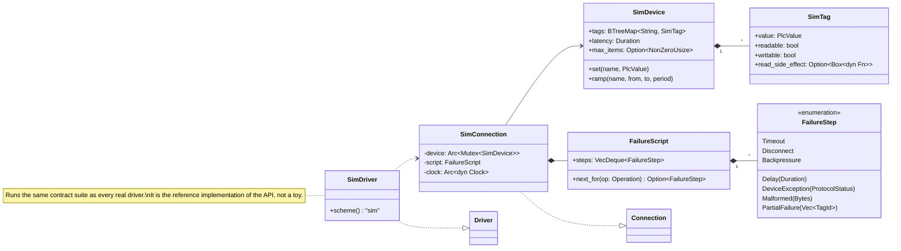

**Shipped at alpha (ADR-0012).** The `stonecrab::sim` module (feature `sim`) ships `SimDriver` (scheme
`sim`; `sim://<device>?latency-ms=<n>&seed=<u64>`; `new()`, `with_clock(Arc<dyn Clock>)`,
`with_device`, `device`), `SimConnection`, `SimDevice`, `SimTag`, `SimAddress`
(`STATE|RANDOM|SINK/<name>:<type>`), `FailureScript`, `FailureStep` and `RealtimeClock`.
The script lives on the shared `SimDevice` rather than on each connection, so every
connection to a device consumes the same queue, one step per operation. The step set is
`Delay`, `Timeout`, `Disconnect`, `DeviceException`, `Malformed`, `PartialFailure`,
`Backpressure` and `UnknownAfterTransmit`. The simulator implements `read` and `write`
(`write` is rejected under `AccessPolicy::ReadOnly`), has one in-flight slot with no wait
queue (a second operation is `Backpressure`), applies bounded read retry and never retries
a write. It is Tokio-free and uses `RealtimeClock` unless a test injects a `FakeClock`. It
runs the same contract suite as `stonecrab::modbus`, as the note beside the diagram says.

---

## 6. `stonecrab::sensors` and board adapters

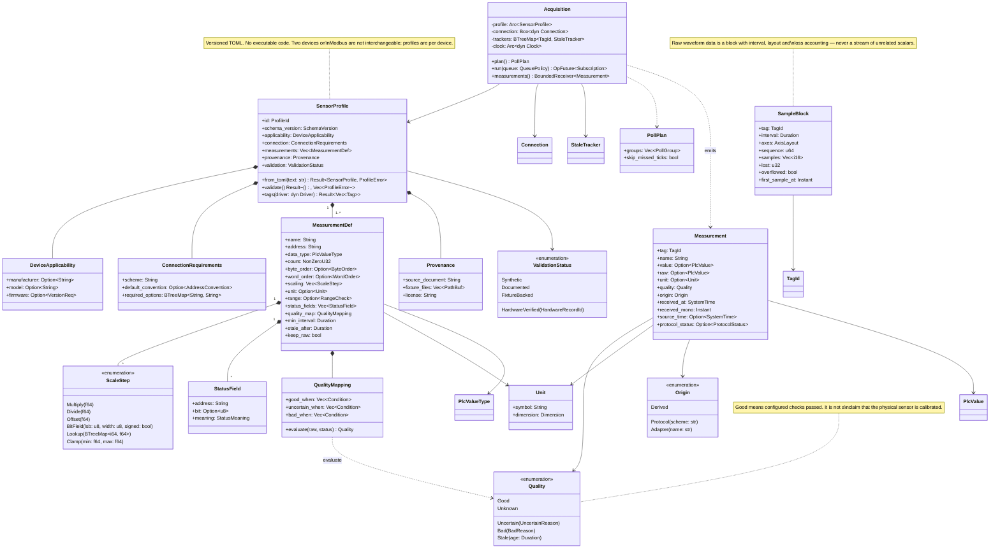

**Shipped at alpha (ADR-0016).** The `stonecrab::sensors` module (feature `sensors`) ships the schema (version 1), the
loader, validation, the tag builder and the measurement pipeline; board adapters and the
acquisition loop are deferred.

- `SensorProfile::from_toml(&str) -> Result<SensorProfile, ProfileError>` (64 KiB
  bound checked before parsing, unknown keys denied), `validate(&self)
  -> Result<(), Vec<ProfileError>>` (every error, never just the first),
  `tags(&self, &dyn Driver) -> Result<Vec<Tag>, ProfileError>` and `measurements(&self,
  &ReadResponse, wall_now: SystemTime) -> Vec<Measurement>`. `tags` refuses a driver whose
  scheme differs from the profile's `connection.scheme`, passes the profile's declared
  `address_convention` as `AddressOptions` to every `Driver::parse_address` call, and adds
  one `<measurement>.<status name>` tag per status field.
- `address_convention` is mandatory when the scheme is `modbus-tcp` and optional for
  `sim`; a profile belongs to one scheme and a device reachable through two schemes has two
  files (D17). Profiles are repository data under `profiles/synthetic/` (temperature,
  pressure/flow/level and discrete state, each a `modbus-tcp` file and a `sim` twin),
  labeled `synthetic`; no named device profile exists.
- `Measurement` has `value`, `raw` (the unscaled typed value when `keep_raw`, not wire
  bytes), `unit`, `quality`, `origin`, `received_at`, `received_mono`, `source_time` (never
  substituted) and `protocol_status`. `Quality` is `Good`, `Uncertain`, `Bad`, `Stale`,
  `Unknown` with precedence `Bad`, `Stale`, `Uncertain`, `Unknown`, `Good`; `Stale` is
  produced only by the M2 tracker. Scaling is checked and ordered (`multiply`, `divide`,
  `offset`, `clamp`, `bit_field`); integers stay integers while every step is integral.
- **Deferred:** `Acquisition`, queues and the polling loop (M2), `StaleTracker` (M2),
  `Lookup` scale steps and named device profiles (M2), the `max31855` and
  `adxl345` board adapters (M2S). Section 6.1 is entirely deferred to M2S.

Section 9.7 shows the target pipeline with `Acquisition`; at the alpha an application calls
`tags`, reads through a `Connection`, then calls `measurements` itself, as the
`profile_read` example does.

### 6.1 Direct bench adapters

**Deferred (M2S).** Nothing in this section ships at the alpha: no board adapter, no
`adapters-linux` feature and no hardware runner exist, and no hardware record exists
(`docs/hardware/TEMPLATE.md` is the only artifact).

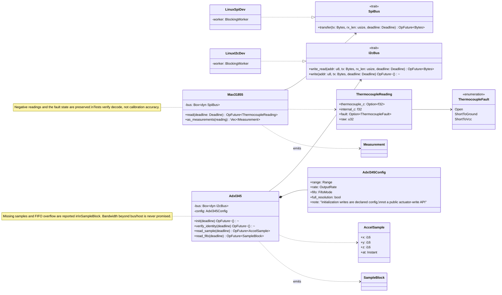

---

## 7. `stonecrab::testkit`

```mermaid
classDiagram
    direction TB

    class FakeClock {
        -now: Arc~Mutex~Instant~~
        -sleepers: BTreeMap~Instant, Vec~Waker~~
        +advance(Duration)
        +set(Instant)
    }

    class FakeTransport {
        -script: Script
        -tx_log: Vec~Bytes~
        +with_script(Script) FakeTransport
        +sent() Vec~Bytes~
    }

    class Script {
        +steps: VecDeque~Step~
        +strict: bool
    }

    class Step {
        <<enumeration>>
        Expect(Bytes)
        Reply(Bytes)
        ReplyFragmented(Vec~Bytes~)
        ReplyCoalescedWithNext
        Delay(Duration)
        CloseAt(offset: usize)
        Truncate(len: usize)
        WrongTransactionId
        LateReply(after: Duration)
    }

    class ScriptedPeer {
        -listener: TcpListener
        -script: Script
        +addr() SocketAddr
        +spawn(Script) ScriptedPeer
    }

    class VirtualSerialPair {
        +master: PathBuf
        +slave: PathBuf
        +inject_crc_error()
        +inject_gap(Duration)
    }

    class GoldenVector {
        +name: String
        +wire: Bytes
        +expected: serde_json::Value
        +source: VectorSource
        +must_fail: Option~ParseErrorKind~
    }

    class VectorSource {
        <<enumeration>>
        UpstreamFixture(path: PathBuf, rev: String)
        ProtocolSpec(section: String)
        Captured(device: String, firmware: String)
        Adversarial
    }

    class ContractSuite {
        +run(driver: Arc~dyn Driver~, cfg: ConnectionConfig) ContractReport
        +cases() Vec~ContractCase~
    }

    class ContractCase {
        +name: str
        +requires: Operation
        +run(conn: dyn Connection) CaseResult
    }

    class DifferentialRunner {
        +rust: Arc~dyn Driver~
        +upstream: UpstreamHarness
        +normalize(ReadResponse) NormalizedResponse
        +compare(fixture) DiffReport
    }

    class UpstreamHarness {
        +note: "pinned PLC4J via subprocess; maintainer-only"
    }

    class HardwareRecord {
        +device_model: String
        +firmware: String
        +adapter: String
        +wiring: String
        +host: HostInfo
        +library_commit: String
        +operations: Vec~Operation~
        +load: String
        +result: TestOutcome
        +evidence_paths: Vec~PathBuf~
    }

    FakeClock ..|> Clock
    FakeTransport ..|> Transport
    FakeTransport *-- Script
    Script "1" *-- "*" Step
    ScriptedPeer *-- Script
    GoldenVector --> VectorSource
    ContractSuite "1" *-- "*" ContractCase
    ContractSuite ..> Driver
    DifferentialRunner --> Driver
    DifferentialRunner --> UpstreamHarness

    note for ContractSuite "The same suite runs against the simulator and every\nreal driver. Capability claims are checked, not trusted."
    note for GoldenVector "Round trip alone can hide a matching encode/decode bug.\nexpected is independently authored, not derived."
```

**Shipped at alpha (ADR-0009, ADR-0018).** The testkit is the `stonecrab::testkit` module
behind the off-by-default `testkit` feature; it is not a runtime feature, and it lives in
the crate because a separate test crate would be a dev-dependency cycle. It ships
`FakeClock`, `block_on`, `block_on_with`, `poll_once`, `CountingWaker` and `FixtureAddress`;
`Script`, `Step` (including `Respond` and `React`), `Reaction`, `ScriptedPeer`,
`ScriptedPeerFactory`, `FakeTransport`, `FakeTransportFactory`, `CountingFactory` and
`LengthPrefixedFramer`; the golden-vector loader (`load_dir`, `GoldenVector`,
`VectorSource`) and `InteropMap`; and `ContractSuite` (27 cases, `ContractFixture`,
`ContractReport`) which every driver runs and which driver authors can run against their
own driver. The loaders and some of its tests read repository files, so they run from a
checkout. **Deferred:** `DifferentialRunner` and `UpstreamHarness` (M5), the
hardware runner and `HardwareRecord` (M2S). Since S04a the upstream parser-suite frames
are vectors beside the first-party ones, and since S04b so are the driver-suite and
all-datatypes read exchanges (a test-only adapter, not a testkit item).

---

## 8. Connection lifecycle

One owner per connection. The driver wraps `ConnectionGuard`, which holds exactly the
state machine drawn here. The diagram is the shipped one and replaces the original target
diagram; the transitions the original showed that the alpha does not implement are listed
under "Deferred" below, not dropped silently.

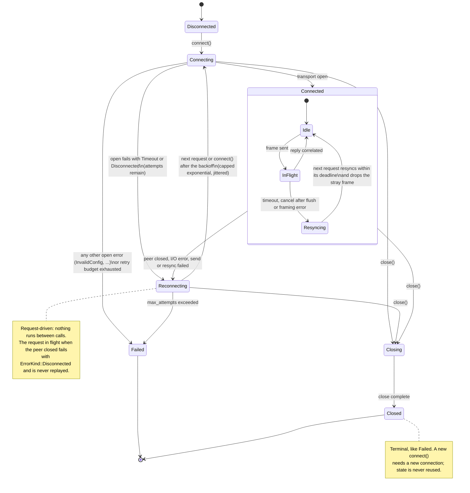

**Shipped at alpha (ADR-0007, ADR-0011, ADR-0014).**

- The machine lives in `ConnectionGuard` (`stonecrab::transport`) and is observable through
  core's `ConnectionState`, held in a `StateCell` that every `watch_state()` reads. The
  private sub-states `Idle`, `InFlight` and `Resyncing` are not part of the public state.
  `ModbusConnection` and `ModbusSession` report the guard's state unchanged; the simulator
  runs its own, smaller lifecycle (`Disconnected`, `Connecting`, `Connected`, `Closing`,
  `Closed`, plus `Failed(Disconnected)` after a scripted disconnect) through the same
  `StateCell`.
- **Reconnect is request-driven (D15).** There is no background task. After a failure the
  state is `Reconnecting { attempt, next_at }` with `next_at = now + next_delay(attempt - 1,
  sample)`; the next request (or `connect`) sleeps until `next_at` on the clock,
  cancellably and within its own deadline, reopens within `Timeouts.connect` and carries on.
  One request makes one open attempt. When `ReconnectPolicy::is_exhausted` says so the state
  is `Failed(Disconnected)` and every later request fails with `Disconnected` before any
  I/O. Only a received reply resets the attempt count: a peer that accepts and then closes
  keeps spending the budget. A `close` during the backoff ends `Closed`.
- **Timeout, cancel and late replies.** A request that times out, is cancelled after its
  frame went out or hits a framing error leaves the guard `Connected` with the stream marked
  as possibly owing bytes. Before the next send, if bytes the guard cannot account for are
  buffered, it runs `FramedTransport::resync` within that request's deadline; if no frame
  boundary is found in time the request fails with `Disconnected` and the guard reconnects.
  A reply that arrives whole afterwards is discarded by the session, by correlation (the
  transaction id, unit id and function code), not by the guard.
- **One in flight, a bounded line behind it.** At most `max_pending_requests` requests are
  owned at once; one more is `Backpressure` before any I/O. The Modbus connection and the
  simulator allow one read in flight and answer a second with `Backpressure`.
- **`close`** is bounded by `Timeouts.request`, always ends `Closed` and wakes every wait
  the guard owns.

**Deferred:** the RTU variant of `Resyncing` ("drain until t3.5 silence", M2); the
`idle timeout` transition into `Reconnecting` (`Timeouts.idle` is recorded and unenforced,
M2); "subscriptions receive `Ended`" on close (no subscriptions, M2); pending writes
resolving to `WriteOutcome::Unknown` on reconnect (the Modbus driver sends no write; the
simulator models it with `UnknownAfterTransmit`); and an eager background reconnect task
(first M2 slice).

### 8.1 Request lifecycle

Every read, write, browse and subscribe request passes through this machine. Local validation failures never reach the wire.

```mermaid
stateDiagram-v2
    [*] --> Validating
    Validating --> Rejected : InvalidAddress / Unsupported / ReadOnly policy / limits
    Validating --> Queued : ok
    Queued --> Rejected : cancel() → Cancelled\nqueue full → Backpressure
    Queued --> Transmitting : connection Idle
    Transmitting --> Awaiting : bytes flushed
    Transmitting --> Cancelled_Before_Wire : cancel() before flush
    Awaiting --> Completed : response correlated
    Awaiting --> TimedOut : deadline elapsed
    Awaiting --> Cancelled_After_Wire : cancel() after flush
    Awaiting --> Disconnected : transport closed

    TimedOut --> [*] : read → Timeout (retryable per RetryPolicy)\nwrite → Unknown(TimeoutAfterTransmit)
    Cancelled_Before_Wire --> [*] : Cancelled; device saw nothing
    Cancelled_After_Wire --> [*] : read → Cancelled\nwrite → Unknown(CancelledAfterTransmit)
    Disconnected --> [*] : read → Disconnected\nwrite → Unknown(DisconnectedAfterTransmit)
    Completed --> [*]
    Rejected --> [*] : no I/O performed
```

**Shipped at alpha.** The machine is shipped for reads (the Modbus connection and the
simulator) and for simulator writes. Local validation failures never reach the wire: the
Modbus `read` rejects, before any I/O, a closed or failed connection (`Disconnected`), a
cancelled token (`Cancelled`), a non-Modbus address (`InvalidAddress`), a tag count above one
(`InvalidConfig`) and a batch over the item budget (`ResourceLimit`), and an expired
request deadline is `Timeout` before the wire. `Queued` is the guard's admission queue; the
connections themselves answer a concurrent request with `Backpressure` rather than queueing
it. The write rows of the diagram apply to the simulator only (Modbus writes are
deferred, D3), and browse and subscribe requests do not exist (M3 and M2). A read that
times out is retried per `RetryPolicy` (default one attempt), a write never.

---

## 9. Sequences

| Sequence | Status at the alpha | Differences from the diagram |
| --- | --- | --- |
| 9.1 Connect through the registry | shipped | the connection-string parameter is `default-unit-identifier` (corrected in the diagram); the driver is built with its transport factory and clock, `ModbusConnection::open` creates the `ConnectionGuard` |
| 9.2 Batched read with split and partial failure | shipped | the exception is mapped per D18 (`0x02` is `InvalidAddress`, not `DeviceException`); the Modbus connection runs the chunks one after another |
| 9.3 Timeout, late reply, resynchronization | shipped for TCP | the guard resyncs before the next send; the RTU variant and write `Unknown` outcomes on the wire are deferred (M2 and the write slice) |
| 9.4 Reconnect with backoff | shipped, request-driven | no background sleep: the next request waits out the backoff; no `Subscription` participates (M2) |
| 9.5 Polling subscription | **deferred, M2** | `SubscribeRequest`, `Subscription`, `QueuePolicy`, `LossCounters`, `StaleTracker` and the poll task do not exist |
| 9.6 Write with an ambiguous outcome | **deferred**; simulator only | the Modbus driver rejects writes with `Unsupported` before any I/O; the simulator's `UnknownAfterTransmit` step exercises `Unknown` |
| 9.7 Sensor profile to measurement | partly shipped | `tags` and `measurements` exist; `Acquisition`, address convention `ZeroBased` and the polling loop are deferred (M2); the convention is `plc4x` |

### 9.1 Connect through the registry

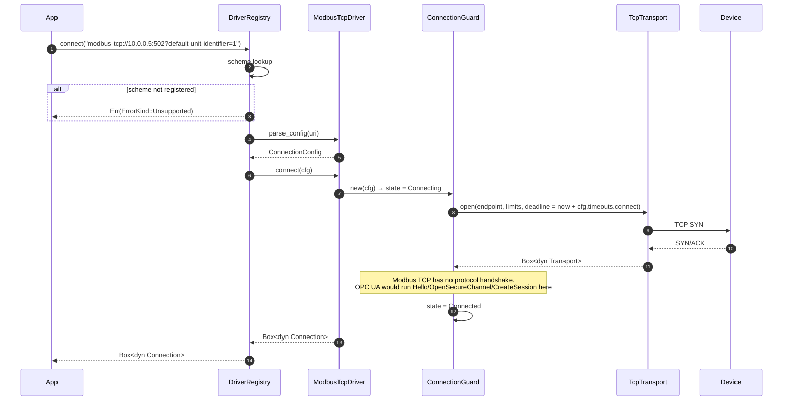

### 9.2 Batched read with split and partial failure

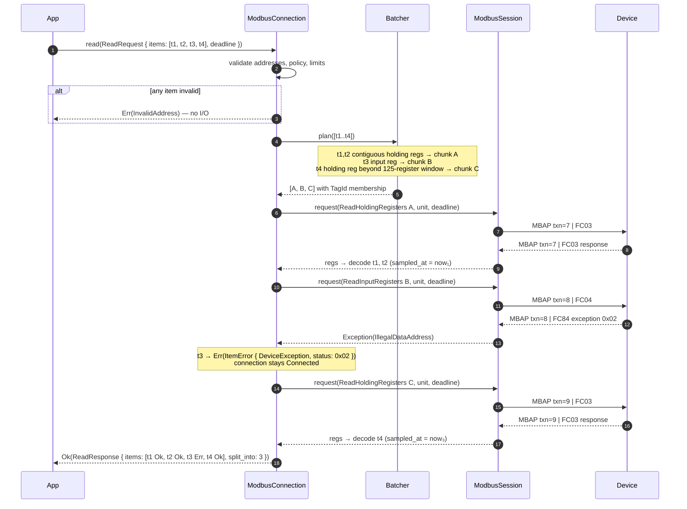

### 9.3 Timeout, late reply, and resynchronization

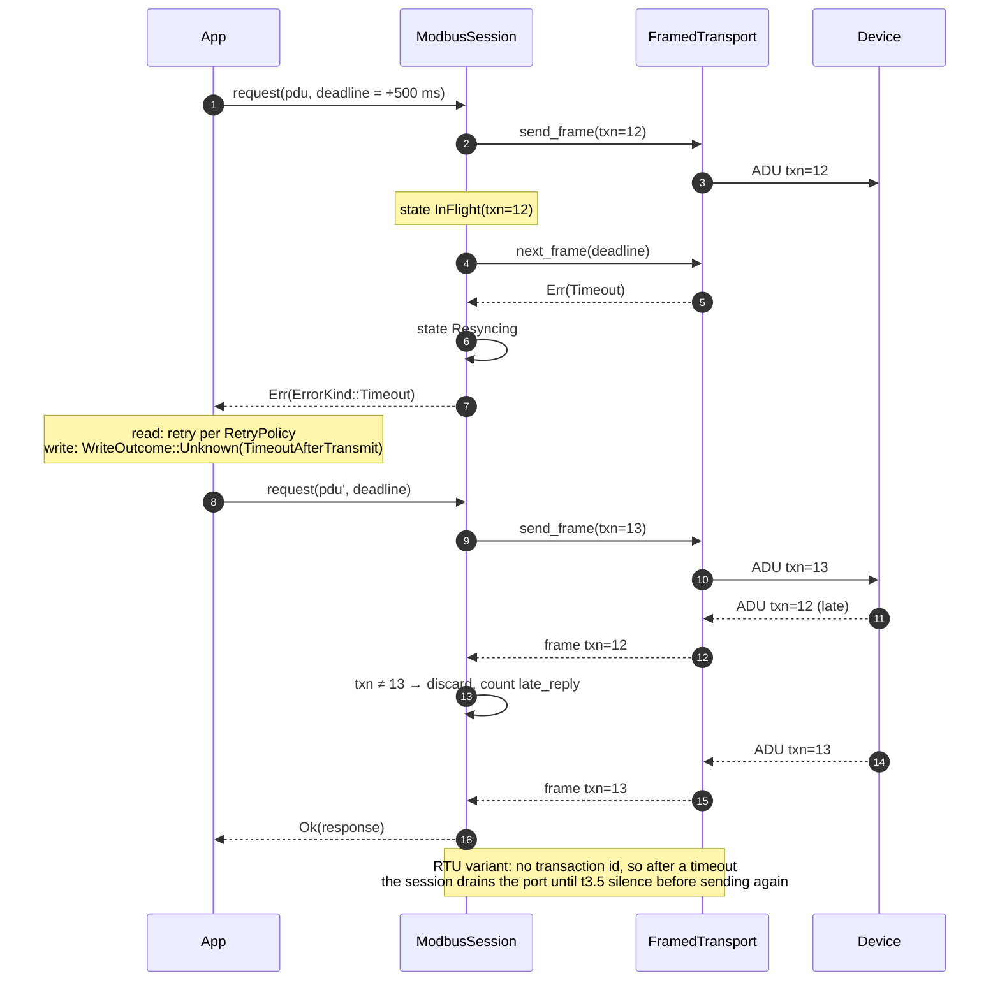

### 9.4 Reconnect with backoff

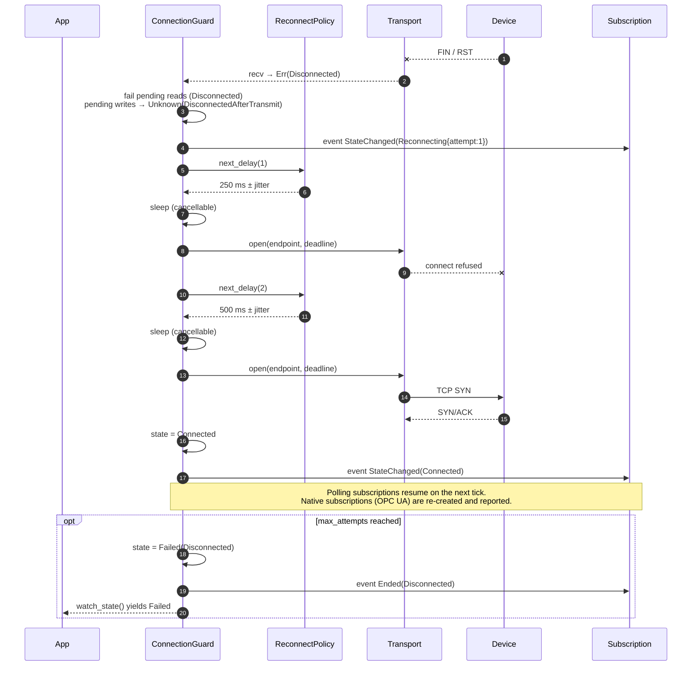

### 9.5 Polling subscription with coalescing, loss accounting, and stale marking

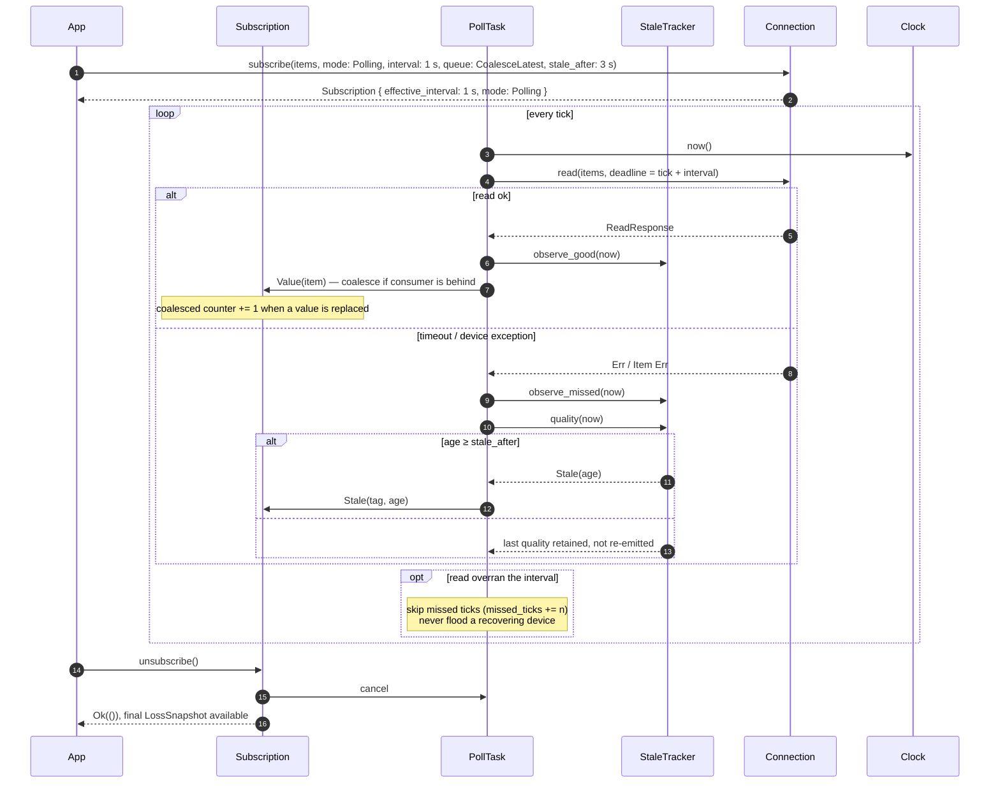

### 9.6 Write with an ambiguous outcome

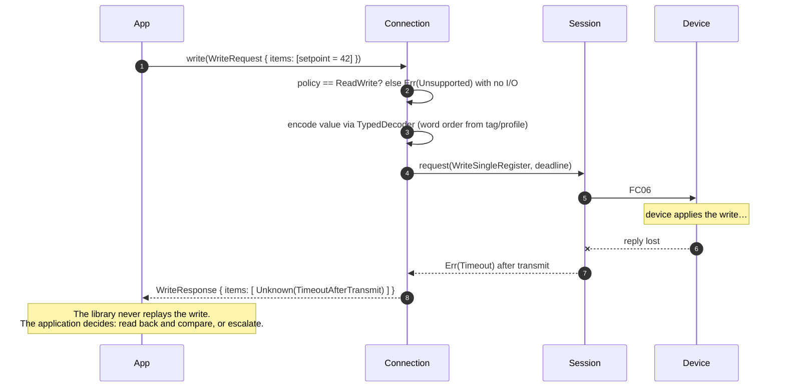

### 9.7 Sensor profile → measurement pipeline

```mermaid
sequenceDiagram
    autonumber
    participant App
    participant Prof as SensorProfile
    participant Drv as Driver
    participant Acq as Acquisition
    participant Conn as Connection
    participant Scale as ScaleStep chain
    participant QM as QualityMapping

    App->>Prof: from_toml("profiles/acme-tx100.toml")
    Prof->>Prof: validate(): overlapping bit fields, counts, conventions, schema version
    alt invalid
        Prof-->>App: Err(Vec<ProfileError>)
    end
    App->>Prof: tags(driver)
    Prof->>Drv: parse_address("holding:0x0010", convention: ZeroBased)
    Drv-->>Prof: ModbusAddress
    Prof-->>App: Vec<Tag> (TagId = measurement name)
    App->>Acq: new(profile, connection, clock)
    App->>Acq: run(queue: Backpressure(64))
    loop per poll group
        Acq->>Conn: read(group tags)
        Conn-->>Acq: ReadResponse
        Acq->>Scale: apply in declared order (Multiply → Offset → Clamp)
        Scale-->>Acq: scaled f64 or exact integer (non-finite → Bad)
        Acq->>QM: evaluate(raw, status_fields)
        QM-->>Acq: Quality
        Acq-->>App: Measurement { value, raw (if keep_raw), unit, quality, received_at, source_time: None }
    end
```

---

## 10. Cargo features

The shipped features of the one crate. All are additive, and enabling one never opens a
network endpoint or starts hardware discovery (parsing a connection string or an address
opens no socket).

| Feature | Enables | Pulls in | Default |
| --- | --- | --- | --- |
| `sim` | `stonecrab::sim`, the in-process simulator | `tracing` | yes |
| `modbus` | `stonecrab::modbus`, Modbus TCP reads | `transport` (so Tokio) and `tracing`; the codec is always built | yes |
| `sensors` | `stonecrab::sensors`, profiles and the TOML loader | `serde` and `toml` | yes |
| `full` | the same set as the defaults, spelled out; the `profile_read` example requires it | `sim`, `modbus` and `sensors` | no |
| `transport` | `stonecrab::transport`, deadline-bounded transports and `TcpTransport` | Tokio (`rt`, `net`, `time`, `sync`, `io-util`) | no (on through `modbus`) |
| `testkit` | `stonecrab::testkit`, fixtures and the driver contract suite; not a runtime feature | `transport`, `serde`, `serde_json`, `toml`, Tokio `macros` | no |

`cargo add stonecrab` therefore gives the simulator, Modbus TCP and the sensor profiles.
`default-features = false` gives the core and the codec only, which pull `thiserror` and
`bytes` and no Tokio; a constrained target picks what it needs from there. The `features`
job checks the feature powerset (depth 2) and the crate without default features, so
every combination builds and exposes its traits and types. The quality gates run with
`--all-features`; a plain `cargo test` runs the reduced suite without the `testkit`
tests (ADR-0018).

**Deferred (not declared):** the features `modbus-rtu`, `opcua`, `eip`, `s7`, `ads`, `slmp`
and `adapters-linux`, and the transport features `udp` and `serial`. They arrive with
their modules (RTU and serial in M2, OPC UA in M3, EtherNet/IP and S7 in M4, the board
adapters in M2S).

---

## 11. What this document does not decide

- Exact MSpec constructs supported at M1 (decided in M0 inventory).
- Whether `PlcValue::Date/Time/DateTime` are `std::time::SystemTime`-based or a dedicated calendar type (decided by an ADR before M1; `chrono`/`time`/`jiff` are not permitted in the core by default).
- OPC UA session and security-channel class structure (M3 design doc).
- The C ABI, dynamic loading, and `no_std` subsets (post-M5 extensions).
