# Stonecrab Architecture

**Status:** design document, derived from the [engineering specification](./SPEC.md). No code exists yet; every type below is a target, not a description of shipped behavior. Names are provisional until M0 pins the upstream baseline.

This document is the diagram set for the workspace. It is organized from the outside in: crate graph first, then the public contract in `stonecrab-core`, then the layers beneath it, then the dynamic behavior (state machines and sequences) that the static diagrams cannot show.

Every diagram is Mermaid so it renders on GitHub and in `cargo doc` via `#![doc = include_str!(...)]` with `rustdoc`'s `--html-in-header` mermaid shim if we choose to embed it later.

## Notation

| Mark | Meaning |
| --- | --- |
| `<<trait>>` | Rust trait. Object-safe unless noted; the public driver boundary is always object-safe. |
| `<<enumeration>>` | Rust `enum`. All public enums are `#[non_exhaustive]`. |
| `<<newtype>>` | Single-field tuple struct used for type safety (`TagId`, `UnitId`). |
| `<<generated>>` | Produced by the MSpec → Rust generator; never hand-edited. |
| `OpFuture~T~` | `Pin<Box<dyn Future<Output = Result<T, PlcError>> + Send + '_>>` — the boxed future used at the object-safe boundary. |
| `Result~T~` | `Result<T, PlcError>` unless an error type is named. |
| `A --> B` | A holds or references B. |
| `A ..> B` | A uses B transiently (argument, return, or construction). |
| `A ..|> B` | A implements trait B. |
| `A *-- B` | A owns B (composition). |

Lifetimes, `Send + Sync` bounds, and `#[derive]` lists are omitted from the diagrams; the [coding standards](./CODING_STANDARDS.md) define the mandatory bounds and derives.

---

## 1. Workspace crate graph

Dependencies point downward only: applications → facade → drivers → transport/codec → core. Sensor metadata is kept out of wire-level crates. Tooling is never a dependency of a published crate.

```mermaid
flowchart TB
    subgraph apps["Applications (outside the library boundary)"]
        APP["Vorpal, Shatterproof, third-party apps<br/>persistence · dashboards · alerting · ERP"]
        EXAMPLES["examples/"]
    end

    subgraph facade["Facade"]
        STONECRAB["<b>stonecrab</b><br/>public re-exports · driver registration · Cargo feature selection"]
    end

    subgraph drivers["Driver crates — each behind a Cargo feature"]
        SIM["<b>stonecrab-driver-sim</b><br/>simulated device + scripted failures"]
        MODBUS["<b>stonecrab-modbus</b><br/>TCP + RTU over one PDU implementation"]
        OPCUA["<b>stonecrab-opcua</b><br/>secure sessions · read · browse · native subscriptions"]
        EIP["<b>stonecrab-eip</b><br/>EtherNet/IP incl. Logix"]
        S7["<b>stonecrab-s7</b><br/>Siemens S7"]
        REST["…remaining baseline drivers<br/>ADS/AMS · SLMP · BACnet · CAN · proxy"]
    end

    subgraph sensors["Sensor layer"]
        SENSORS["<b>stonecrab-sensors</b><br/>declarative profiles · units · scaling · quality"]
        MAX["<b>stonecrab-adapter-max31855</b><br/>thermocouple over SPI"]
        ADXL["<b>stonecrab-adapter-adxl345</b><br/>accelerometer over I²C (SPI later)"]
    end

    subgraph foundation["Foundation"]
        CORE["<b>stonecrab-core</b><br/>values · tags · requests · errors · driver traits<br/><i>runtime-agnostic, no Tokio</i>"]
        TRANSPORT["<b>stonecrab-transport</b><br/>TCP · UDP · serial · deadlines · cancellation<br/><i>Tokio</i>"]
        CODEC["<b>stonecrab-codec</b><br/>bounded readers/writers · checksums · generated-message support"]
    end

    subgraph tooling["Maintainer tooling — never published, never a dependency"]
        TESTKIT["<b>stonecrab-testkit</b><br/>scripted peers · fake clock · golden vectors · contract suite · differential runner"]
        XTASK["<b>xtask</b><br/>upstream manifest · coverage · release evidence"]
        GEN["<b>stonecrab-codegen</b><br/>MSpec → Rust (maintainer-only; Java/Maven bootstrap allowed at first)"]
    end

    APP --> STONECRAB
    EXAMPLES --> STONECRAB
    APP -. "optional" .-> SENSORS

    STONECRAB --> CORE
    STONECRAB -. "feature = sim" .-> SIM
    STONECRAB -. "feature = modbus" .-> MODBUS
    STONECRAB -. "feature = opcua" .-> OPCUA
    STONECRAB -. "feature = eip" .-> EIP
    STONECRAB -. "feature = s7" .-> S7
    STONECRAB -. "feature = …" .-> REST

    SIM --> CORE
    MODBUS --> CORE
    MODBUS --> TRANSPORT
    MODBUS --> CODEC
    OPCUA --> CORE
    OPCUA --> TRANSPORT
    OPCUA --> CODEC
    EIP --> CORE
    EIP --> TRANSPORT
    EIP --> CODEC
    S7 --> CORE
    S7 --> TRANSPORT
    S7 --> CODEC
    REST --> CORE
    REST --> TRANSPORT
    REST --> CODEC

    TRANSPORT --> CORE
    CODEC --> CORE

    SENSORS --> CORE
    MAX --> SENSORS
    ADXL --> SENSORS

    TESTKIT --> CORE
    TESTKIT --> TRANSPORT
    TESTKIT --> CODEC
    TESTKIT -. "dev-dependency of" .-> MODBUS
    TESTKIT -. "dev-dependency of" .-> OPCUA
    GEN -. "emits committed code into" .-> MODBUS
    GEN -. "emits committed code into" .-> OPCUA
    XTASK -.-> GEN
    XTASK -.-> TESTKIT
```

**Rules encoded in this graph**

- `stonecrab-core` has no runtime dependency. Values, tags, requests, and errors must not change when a second async runtime is added later.
- `stonecrab-transport` is the only foundation crate that depends on Tokio. Serial, SPI, and I²C access never runs on a runtime worker thread.
- Driver crates depend on `stonecrab-transport` and `stonecrab-codec`, never on each other. Shared Modbus PDU logic lives inside `stonecrab-modbus`, not in a cross-driver crate.
- `stonecrab-sensors` depends only on `stonecrab-core`; a profile is data about tags, not about wire bytes.
- Board adapters depend on `stonecrab-sensors` so they share the measurement envelope and quality model, but they are not upstream-parity items.
- A plain `cargo add stonecrab` with default features pulls in `stonecrab-core` and nothing else. Every protocol is opt-in.

---

## 2. Mapping from Apache PLC4X concepts

Behavioral compatibility, not structural translation. This table is the index into the parity records required by the spec.

| PLC4J concept | Stonecrab type | Notes |
| --- | --- | --- |
| `PlcDriverManager` | `DriverRegistry` | Explicit registration; no classpath scanning. Unsupported scheme is a typed error. |
| `PlcDriver` | `trait Driver` | Object-safe. `connect` returns an `OpFuture`. |
| `PlcConnection` | `trait Connection` | Explicit `close`; observable `ConnectionState`. |
| `PlcConnection.getMetadata()` | `Capabilities` | Reports native vs polling subscription honestly. |
| `PlcTag` / address string | `Tag` + `dyn ProtocolAddress` | Driver parses; caller-supplied `TagId` retained end-to-end. |
| `PlcValue` hierarchy | `enum PlcValue` | Exact integer widths preserved; no f64 funnel. |
| `PlcReadRequest` / `PlcReadResponse` | `ReadRequest` / `ReadResponse` | Per-item results correlated by `TagId`; partial failure preserved. |
| `PlcWriteRequest` / `PlcWriteResponse` | `WriteRequest` / `WriteResponse` | Adds `WriteOutcome::Unknown` for ambiguous timeouts. |
| `PlcResponseCode` | `ProtocolStatus` + `ItemError` | Original protocol status kept beside the normalized error. |
| `PlcSubscriptionRequest` | `SubscribeRequest` → `Subscription` | Bounded delivery; `QueuePolicy` and `LossCounters` are mandatory. |
| `PlcBrowseRequest` | `BrowseRequest` / `BrowseResponse` | Distinct from discovery; unsupported → `ErrorKind::Unsupported`. |
| `PlcDiscoveryRequest` | `DiscoverRequest` / `DiscoveredDevice` | Never enabled by merely importing a crate. |
| `PlcConnectionException` etc. | `PlcError { kind: ErrorKind, … }` | One error type; `ErrorKind` is the discriminator. |
| `CompletableFuture<T>` | `OpFuture<T>` | Cancellation semantics documented per operation. |
| MSpec protocol definitions | `stonecrab-codegen` output in each driver | Source revision, generator version, and options recorded with output. |

---

## 3. `stonecrab-core` — public contract

The whole public API surface that applications and drivers agree on. Nothing here knows about any protocol, transport, or runtime.

### 3.1 Driver and connection boundary

```mermaid
classDiagram
    direction TB

    class DriverRegistry {
        -drivers: BTreeMap~str, Arc~dyn Driver~~
        +new() DriverRegistry
        +register(driver: Arc~dyn Driver~) Result~()~
        +driver(scheme: str) Option~Arc~dyn Driver~~
        +schemes() Vec~str~
        +parse(uri: str) Result~ConnectionConfig~
        +connect(uri: str) OpFuture~Box~dyn Connection~~
    }

    class Driver {
        <<trait>>
        +scheme() str
        +capabilities() Capabilities
        +parse_config(uri: str) Result~ConnectionConfig~
        +parse_address(address: str) Result~Box~dyn ProtocolAddress~~
        +connect(cfg: ConnectionConfig) OpFuture~Box~dyn Connection~~
    }

    class Connection {
        <<trait>>
        +state() ConnectionState
        +watch_state() StateWatch
        +capabilities() Capabilities
        +read(req: ReadRequest) OpFuture~ReadResponse~
        +write(req: WriteRequest) OpFuture~WriteResponse~
        +subscribe(req: SubscribeRequest) OpFuture~Subscription~
        +browse(req: BrowseRequest) OpFuture~BrowseResponse~
        +discover(req: DiscoverRequest) OpFuture~Vec~DiscoveredDevice~~
        +close() OpFuture~()~
    }

    class ConnectionConfig {
        +scheme: String
        +endpoint: Endpoint
        +options: BTreeMap~String, String~
        +timeouts: Timeouts
        +reconnect: ReconnectPolicy
        +read_retry: RetryPolicy
        +policy: AccessPolicy
        +limits: ResourceLimits
        +credentials: Option~Secret~Credentials~~
        +builder() ConnectionConfigBuilder
    }

    class Endpoint {
        <<enumeration>>
        Tcp(host, port)
        Udp(host, port)
        Serial(SerialSettings)
        Custom(String)
    }

    class Timeouts {
        +connect: Duration
        +request: Duration
        +idle: Option~Duration~
    }

    class ReconnectPolicy {
        +initial: Duration
        +max: Duration
        +multiplier: f64
        +jitter: Jitter
        +max_attempts: Option~u32~
        +next_delay(attempt: u32, rng) Duration
    }

    class RetryPolicy {
        +max_attempts: u32
        +retry_on: ErrorKindSet
        +note: "reads only — writes are never auto-retried"
    }

    class AccessPolicy {
        <<enumeration>>
        ReadOnly
        ReadWrite
    }

    class ResourceLimits {
        +max_frame_bytes: NonZeroUsize
        +max_buffered_bytes: NonZeroUsize
        +max_pending_requests: NonZeroUsize
        +max_queued_events: NonZeroUsize
        +max_items_per_request: Option~NonZeroUsize~
    }

    class Capabilities {
        +read: bool
        +write: bool
        +subscribe: SubscriptionMode
        +browse: bool
        +discover: bool
        +max_items_per_request: Option~NonZeroUsize~
        +max_pdu_bytes: Option~NonZeroUsize~
        +concurrency: NonZeroUsize
        +supports(op: Operation) bool
    }

    class SubscriptionMode {
        <<enumeration>>
        Unsupported
        Native
        Polling
    }

    class ConnectionState {
        <<enumeration>>
        Disconnected
        Connecting
        Connected
        Reconnecting(attempt: u32, next_at: Instant)
        Closing
        Closed
        Failed(ErrorKind)
    }

    class StateWatch {
        +current() ConnectionState
        +changed() OpFuture~ConnectionState~
    }

    class Secret~T~ {
        <<newtype>>
        -inner: T
        +expose() T
        +Debug prints REDACTED
    }

    DriverRegistry "1" o-- "*" Driver : registers
    DriverRegistry ..> ConnectionConfig : parses
    Driver ..> ConnectionConfig : accepts
    Driver ..> Connection : creates
    Driver ..> Capabilities : reports
    ConnectionConfig *-- Endpoint
    ConnectionConfig *-- Timeouts
    ConnectionConfig *-- ReconnectPolicy
    ConnectionConfig *-- RetryPolicy
    ConnectionConfig *-- AccessPolicy
    ConnectionConfig *-- ResourceLimits
    ConnectionConfig --> Secret~T~ : credentials
    Connection --> Capabilities
    Connection --> ConnectionState
    Connection --> StateWatch
    Capabilities --> SubscriptionMode
    ConnectionState ..> ErrorKind : Failed carries

    note for Driver "Object-safe. Drivers are stateless factories;\nall per-connection state lives behind Connection."
    note for Connection "Every method has documented cancel-safety.\nRequests rejected during local validation perform no I/O."
    note for RetryPolicy "Applies to reads only. Some registers have read\nside effects, so the budget is per-connection configurable."
```

### 3.2 Tags, addresses, and values


### 3.3 Requests, responses, and errors


### 3.4 Time and cancellation primitives

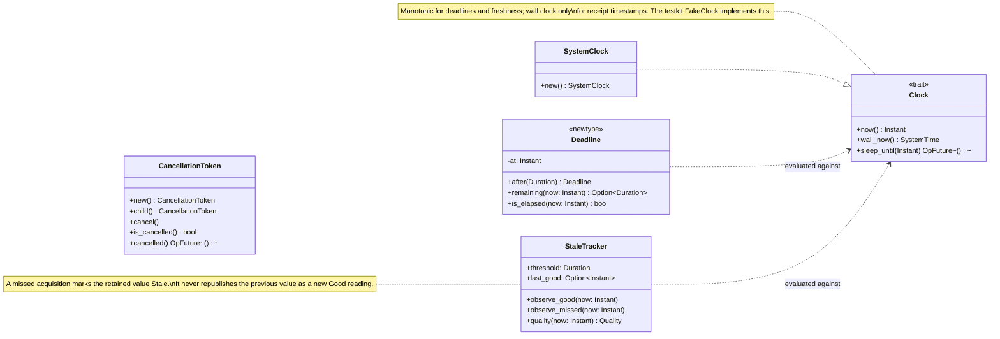

---

## 4. `stonecrab-transport` and `stonecrab-codec`

### 4.1 Transport

```mermaid
classDiagram
    direction TB

    class Transport {
        <<trait>>
        +send(frame: Bytes, deadline: Deadline) OpFuture~()~
        +recv(buf: BytesMut, deadline: Deadline) OpFuture~usize~
        +shutdown() OpFuture~()~
        +peer() String
        +limits() ResourceLimits
    }

    class TransportFactory {
        <<trait>>
        +open(endpoint: Endpoint, limits: ResourceLimits, deadline: Deadline) OpFuture~Box~dyn Transport~~
    }

    class TcpTransport {
        -stream: TcpStream
        -limits: ResourceLimits
        +nodelay: bool
        +keepalive: Option~Duration~
    }

    class UdpTransport {
        -socket: UdpSocket
        -peer: SocketAddr
        -limits: ResourceLimits
    }

    class SerialTransport {
        -port: SerialPort
        -worker: BlockingWorker
        -settings: SerialSettings
        +inter_frame_silence() Duration
        +drain(deadline: Deadline) OpFuture~()~
    }

    class SerialSettings {
        +path: PathBuf
        +baud: u32
        +data_bits: DataBits
        +parity: Parity
        +stop_bits: StopBits
        +flow_control: FlowControl
    }

    class BlockingWorker {
        -thread: JoinHandle
        -tx: BoundedSender~SerialCommand~
        +note: "dedicated OS thread; never blocks a runtime worker"
    }

    class Framer~F~ {
        <<trait>>
        +decode(buf: BytesMut) Result~Option~F~, ParseError~
        +encode(frame: F, out: BytesMut) Result~(), ParseError~
        +max_frame_bytes() NonZeroUsize
    }

    class FramedTransport~F~ {
        -inner: Box~dyn Transport~
        -framer: Box~dyn Framer~F~~
        -rx_buf: BytesMut
        +next_frame(deadline: Deadline) OpFuture~F~
        +send_frame(frame: F, deadline: Deadline) OpFuture~()~
        +resync() OpFuture~()~
    }

    class ConnectionGuard {
        -state: ConnectionState
        -pending: Option~PendingRequest~
        -reconnect: ReconnectPolicy
        -cancel: CancellationToken
        +note: "one owner per connection; drivers wrap this"
    }

    TcpTransport ..|> Transport
    UdpTransport ..|> Transport
    SerialTransport ..|> Transport
    SerialTransport *-- SerialSettings
    SerialTransport *-- BlockingWorker
    TransportFactory ..> Transport : opens
    FramedTransport~F~ --> Transport
    FramedTransport~F~ --> Framer~F~
    ConnectionGuard --> FramedTransport~F~
    ConnectionGuard --> ReconnectPolicy
    ConnectionGuard --> CancellationToken

    note for Transport "Every call takes a Deadline. There is no unbounded I/O\nanywhere in the workspace."
    note for FramedTransport~F~ "Owns the receive buffer so TCP fragmentation and\ncoalescing are invisible to the driver."
```

### 4.2 Codec primitives and generated-message support

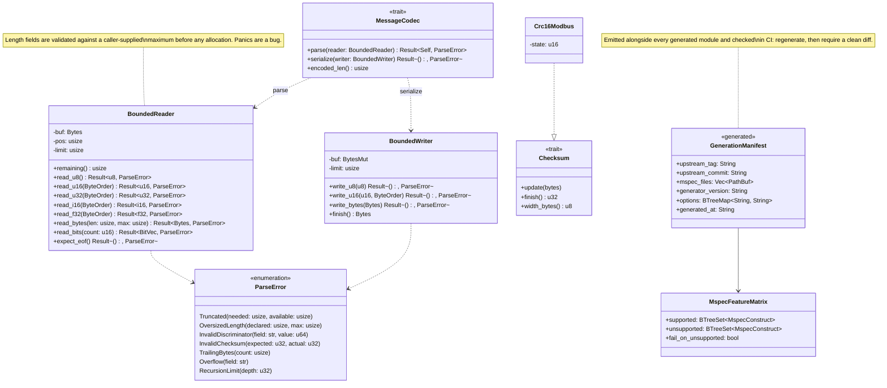

---

## 5. `stonecrab-modbus` — first real driver

TCP and RTU share one PDU implementation. Only framing (MBAP vs. RTU + CRC) and session rules differ.


### 5.1 Simulator driver


---

## 6. `stonecrab-sensors` and board adapters


### 6.1 Direct bench adapters


---

## 7. `stonecrab-testkit`


---

## 8. Connection lifecycle

One owner per connection. The driver wraps `ConnectionGuard`, which holds exactly this state machine.

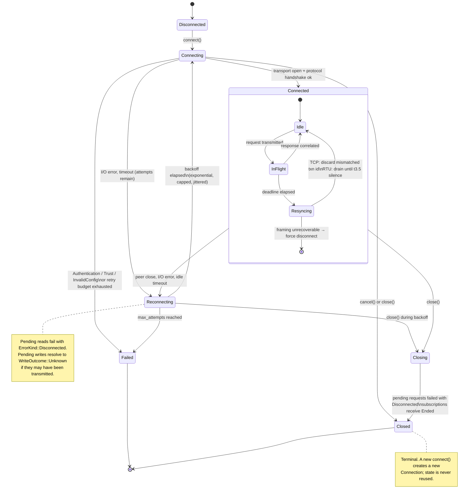

### 8.1 Request lifecycle

Every read, write, browse and subscribe request passes through this machine. Local validation failures never reach the wire.

```mermaid
stateDiagram-v2
    [*] --> Validating
    Validating --> Rejected : InvalidAddress / Unsupported / ReadOnly policy / limits
    Validating --> Queued : ok
    Queued --> Rejected : cancel() → Cancelled\nqueue full → Backpressure
    Queued --> Transmitting : connection Idle
    Transmitting --> Awaiting : bytes flushed
    Transmitting --> Cancelled_Before_Wire : cancel() before flush
    Awaiting --> Completed : response correlated
    Awaiting --> TimedOut : deadline elapsed
    Awaiting --> Cancelled_After_Wire : cancel() after flush
    Awaiting --> Disconnected : transport closed

    TimedOut --> [*] : read → Timeout (retryable per RetryPolicy)\nwrite → Unknown(TimeoutAfterTransmit)
    Cancelled_Before_Wire --> [*] : Cancelled; device saw nothing
    Cancelled_After_Wire --> [*] : read → Cancelled\nwrite → Unknown(CancelledAfterTransmit)
    Disconnected --> [*] : read → Disconnected\nwrite → Unknown(DisconnectedAfterTransmit)
    Completed --> [*]
    Rejected --> [*] : no I/O performed
```

---

## 9. Sequences

### 9.1 Connect through the registry

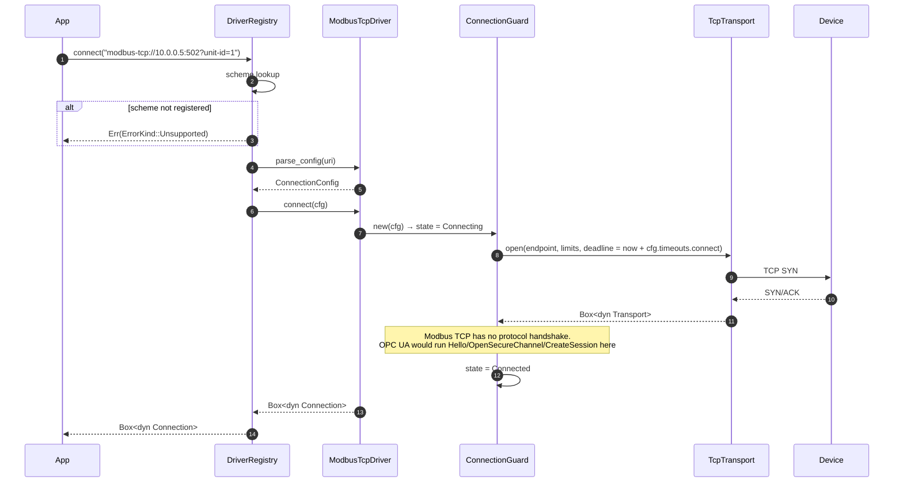

### 9.2 Batched read with split and partial failure

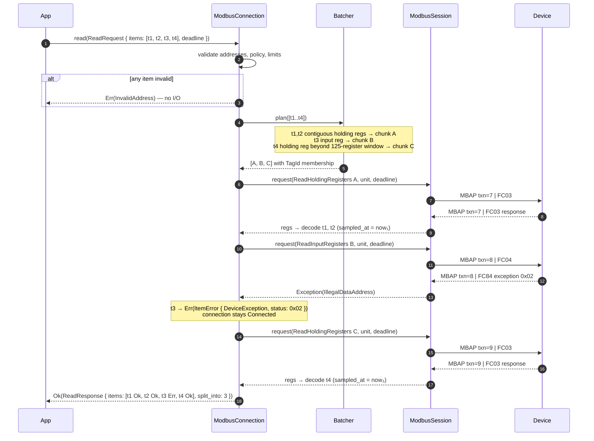

### 9.3 Timeout, late reply, and resynchronization

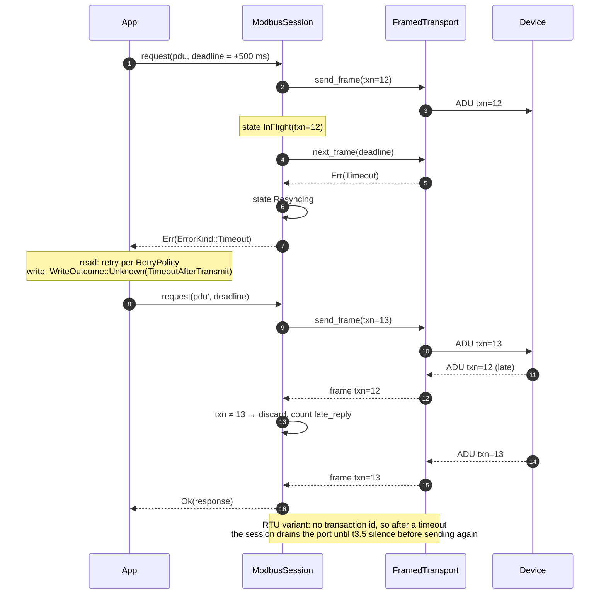

### 9.4 Reconnect with backoff

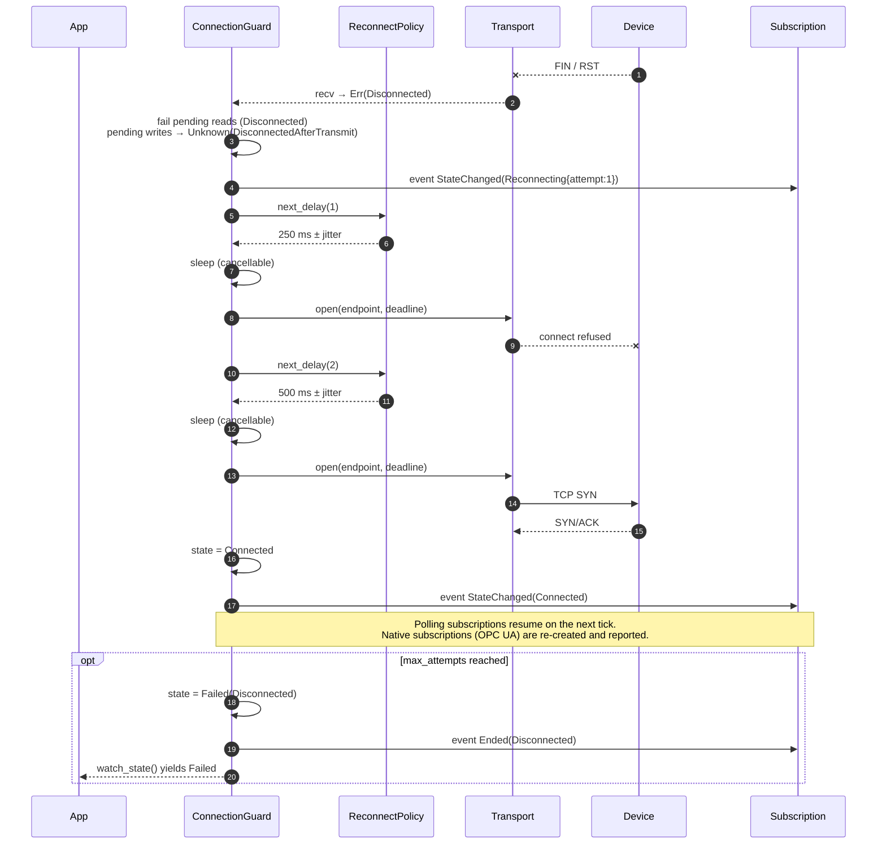

### 9.5 Polling subscription with coalescing, loss accounting, and stale marking

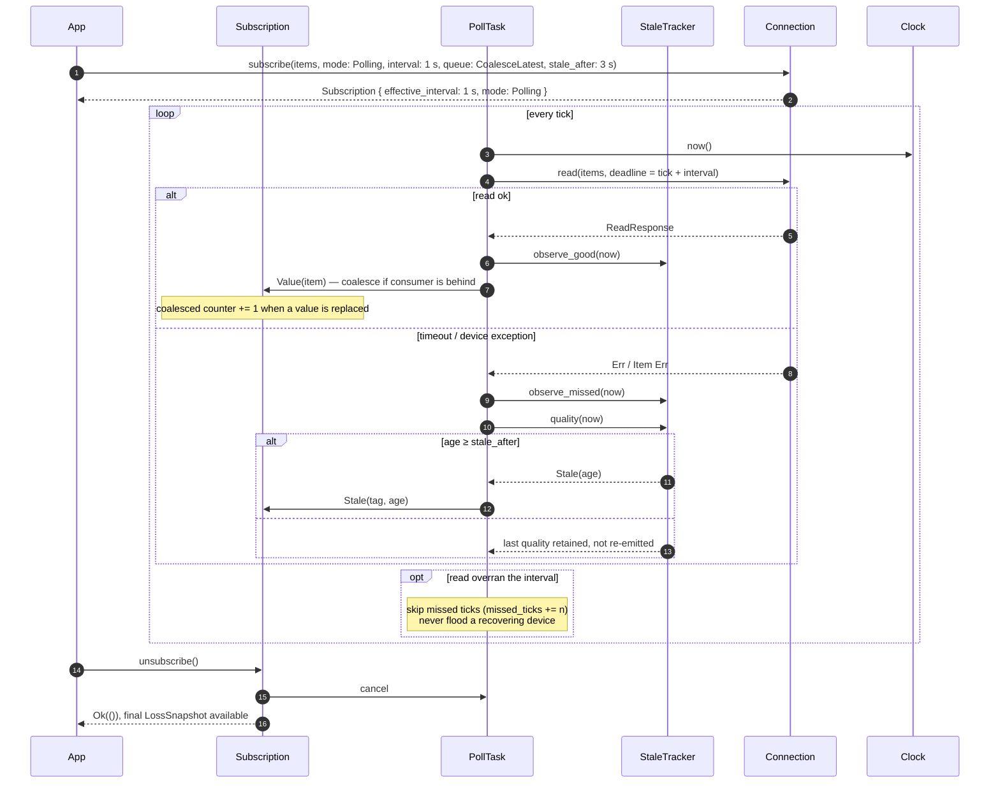

### 9.6 Write with an ambiguous outcome

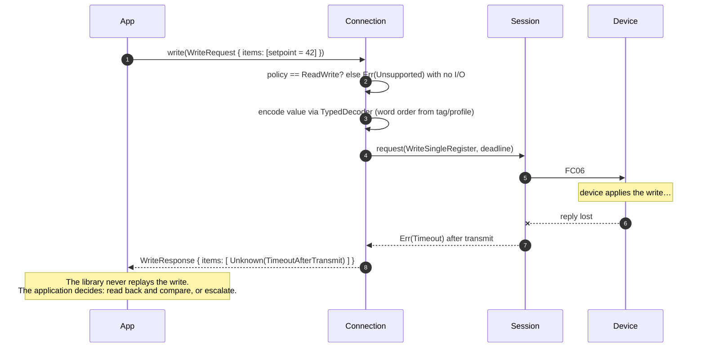

### 9.7 Sensor profile → measurement pipeline

```mermaid
sequenceDiagram
    autonumber
    participant App
    participant Prof as SensorProfile
    participant Drv as Driver
    participant Acq as Acquisition
    participant Conn as Connection
    participant Scale as ScaleStep chain
    participant QM as QualityMapping

    App->>Prof: from_toml("profiles/acme-tx100.toml")
    Prof->>Prof: validate(): overlapping bit fields, counts, conventions, schema version
    alt invalid
        Prof-->>App: Err(Vec<ProfileError>)
    end
    App->>Prof: tags(driver)
    Prof->>Drv: parse_address("holding:0x0010", convention: ZeroBased)
    Drv-->>Prof: ModbusAddress
    Prof-->>App: Vec<Tag> (TagId = measurement name)
    App->>Acq: new(profile, connection, clock)
    App->>Acq: run(queue: Backpressure(64))
    loop per poll group
        Acq->>Conn: read(group tags)
        Conn-->>Acq: ReadResponse
        Acq->>Scale: apply in declared order (Multiply → Offset → Clamp)
        Scale-->>Acq: scaled f64 or exact integer (non-finite → Bad)
        Acq->>QM: evaluate(raw, status_fields)
        QM-->>Acq: Quality
        Acq-->>App: Measurement { value, raw (if keep_raw), unit, quality, received_at, source_time: None }
    end
```

---

## 10. Cargo feature matrix (planned)

| Crate | Feature | Pulls in | Default |
| --- | --- | --- | --- |
| `stonecrab` | `sim` | `stonecrab-driver-sim` | no |
| `stonecrab` | `modbus` | `stonecrab-modbus` (TCP + RTU) | no |
| `stonecrab` | `modbus-rtu` | `stonecrab-modbus/serial` → `stonecrab-transport/serial` | no |
| `stonecrab` | `opcua` | `stonecrab-opcua` | no |
| `stonecrab` | `eip`, `s7`, `ads`, `slmp`, … | respective driver crates | no |
| `stonecrab` | `sensors` | `stonecrab-sensors` | no |
| `stonecrab` | `adapters-linux` | both board adapters with Linux `spidev`/`i2c-dev` backends | no |
| `stonecrab` | `full` | every published driver and sensor crate | no |
| `stonecrab-transport` | `tcp`, `udp`, `serial` | Tokio net / `serialport` + blocking worker | `tcp` |
| `stonecrab-sensors` | `toml` | profile loading from TOML | yes |

Features are additive. No feature may remove an API or change a default behavior. Enabling a feature never opens a network endpoint or starts hardware discovery.

---

## 11. What this document does not decide

- Exact MSpec constructs supported at M1 (decided in M0 inventory).
- Whether `PlcValue::Date/Time/DateTime` are `std::time::SystemTime`-based or a dedicated calendar type (decided by an ADR before M1; `chrono`/`time`/`jiff` are not permitted in `stonecrab-core` by default).
- OPC UA session and security-channel class structure (M3 design doc).
- The C ABI, dynamic loading, and `no_std` subsets (post-M5 extensions).
